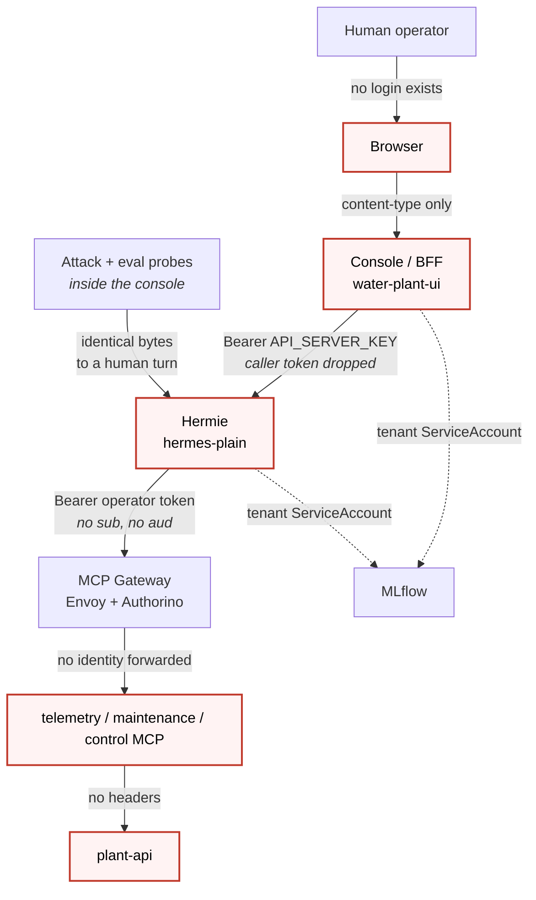

# 01 — Current state

What exists today, with file references. Every factual claim here traces to
[00-verification-findings.md](00-verification-findings.md) or to the named file.

The short version: **identity is not lost somewhere in the chain — it is never created.**
Two synthetic credentials stand in for it, and below the MCP Gateway nothing reads a caller
identity at all.

## Diagram 1 — one identity, and no principal



Every red box is a hop where no principal is present.

## Hop by hop

### Human → browser → console: no authentication at all

`ui/src/waterplant_ui/app.py` has no auth route, no session, no middleware, and
`ui/Containerfile` has no `oauth-proxy`. The front end's only two `fetch` calls with bodies
(`static/app.js:1406-1416` streaming, `:945-948` non-streaming) send exactly
`{"content-type": "application/json"}`, so `request.headers.get("authorization")` is `None` on
every turn.

There *is* a `persona` field (`app.py:546`, default `"operator"`), but it is client-supplied and
unverified, and the identity picker was deliberately removed:

> "The identity picker is gone from the header: every request now asks as the plant operator,
> which is the one identity the lab's scenarios are written against."
> — `static/app.js:990-994`

It is rendered in the transcript prompt and nothing else. On the shipped `openai` protocol it is
dropped before Hermes ever sees it (`harness.py:310-318`).

### Console → agent: a static service credential, and the code says so

`ui/src/waterplant_ui/harness.py:255-270` is the exact point of substitution:

```python
def headers_for(caller_auth, *, sse=False, session_id=None) -> dict[str, str]:
    headers = {"accept": "text/event-stream"} if sse else {}
    if PROTOCOL == "openai":
        # The caller's token is dropped, not forwarded alongside: sending both
        # would imply an identity reaches the agent when none does.
        if AGENT_API_KEY:
            headers["authorization"] = f"Bearer {AGENT_API_KEY}"
```

The module docstring is unusually candid, and worth reading in full (`harness.py:11-17`):

> "**Identity stops here.** […] Hermes authenticates with a single static server key and would
> reject a participant token outright, so on this path the BFF substitutes a service credential
> and the caller's identity does not reach the agent. That is a real reduction in what the lab
> can demonstrate, not an implementation detail."

`identity_is_propagated()` (`harness.py:246-252`) returns `PROTOCOL == "waterplant"` — a pure
environment check, not a runtime one. On that path it reports `True` while nothing is actually
propagated, because the browser sends no token to propagate. The console then reports this to the
front end as `identityPropagated` (`app.py:192`).

`AGENT_API_KEY` **is** populated (length 48, from `hermes-env/API_SERVER_KEY`) — an earlier draft
of these notes wrongly recorded it as empty.

### Agent → MCP Gateway: the one real credential, and it names nobody

`automation/gitops/tenant-platform/files/mcp-token-refresh.py` (byte-identical to the copy in
`tenant-openshell/files/`) does:

```python
data = urllib.parse.urlencode({
    "grant_type": "password",
    "client_id": client_id,      # mcp-gateway   (public, directAccessGrantsEnabled)
    "username": username,        # operator
    "password": password,        # operator
}).encode()
```

written to `$HERMES_HOME/mcp-tokens/gateway.json` at mode 0600, refreshed on `--loop 300`, and
picked up by Hermes through `auth: oauth` on its single `gateway` MCP server entry. The docstring
records that this is deliberate — the agent is capped at the operator persona rather than given a
full-access service account.

What that token actually contains, decoded live:

```
CLAIMS: [azp, exp, groups, iat, iss, jti, resource_access, scope, sid, typ]
  sub: ABSENT   aud: ABSENT   preferred_username: ABSENT
  azp: mcp-gateway        resource_access: 3 clients / 18 tool roles
```

So the design intent ("capped at the operator persona") is *weaker in practice than in the
comment*: there is no operator in the token. There is a client name shared by every caller, and a
role set. See [00-verification-findings.md](00-verification-findings.md) §2 for why — the realm
import replaces Keycloak's built-in client scopes, so no `basic` scope means no `sub` mapper.

### The gateway: where enforcement correctly lives, on the only fact it has

`automation/gitops/tenant-policy/templates/mcp-gateway-policy.yaml` is a two-listener model:
`mcp-auth-policy` authenticates on the public `mcp` listener; `mcp-authz-policy` authorizes on the
internal `mcps` listener with

```cel
('tool:' + request.headers['x-mcp-toolname']) in
  (has(auth.identity.resource_access) &&
   auth.identity.resource_access.exists(p, p == request.headers['x-mcp-servername'])
     ? auth.identity.resource_access[request.headers['x-mcp-servername']].roles : [])
```

Both are `Accepted=True / Enforced=True` live. This is the right place for the check, and it works
— it just has only one fact available to check. Note the documented UX wrinkle: Hermes surfaces a
403 as a dropped connection and reports "a network issue or service outage"
(`mcp-gateway-policy.yaml:37-40`), so Authorino's log is the source of truth.

### Below the gateway: nothing reads identity

The three MCP servers' `client.py` files are **byte-identical** and forward no headers:

```python
_client = httpx.AsyncClient(base_url=settings.PLANT_API_URL, timeout=settings.REQUEST_TIMEOUT_S)
```

with the rationale stated at `client.py:8-10` — "Authorization belongs to MCP Gateway. Putting a
check here would move enforcement into the application and defeat the point of the lab." Their
`settings.py` has no issuer, audience or credential of any kind.

`plant-api` is deliberately unauthenticated (`api.py:3-6`). Control actions —
`set_pump_speed`, `start_pump`, `stop_pump`, `set_valve`, `emergency_shutdown` — mutate state
under a lock and return an `ActionResult`. There is no actor, no timestamp, and no log line:
`grep "log\.\|logging" plant-api/src/plant_api/*.py` returns nothing. There is no audit table.

**The one "who" field in the entire system** is `raised_by` on work orders
(`plant-api/src/plant_api/api.py:298`, `mcp-maintenance/.../maintenance.py:172-174`):

```python
raised_by: Annotated[str, Field(max_length=80, description="Identity of the requester.")] = "unknown"
```

It is an ordinary tool argument the model fills in. Nothing validates it and nothing derives it
from a credential. Seeded work orders carry plausible human handles — `a.okafor`, `s.bramley`
(`maintenance.py:328-349`) — so a model-invented value sits in the same column, indistinguishable.

### MLflow: an audit record of *what*, with no *who*

The bridge mints its own long-lived token (`bridge-supervisor.sh:189-197`):

```bash
oc create token hermes-openshell-bridge -n "$OPENSHELL_NS" --duration="${MLFLOW_TOKEN_DURATION_HOURS}h"
```

at 8760h — one year. Every trace in a tenant is written under that one ServiceAccount, into one
experiment named after the username. `ui/src/waterplant_ui/traces.py` correlates a turn to its
trace by comparing a casefolded 120-character prefix of `request_preview`; there is no user,
subject or actor field on any run, trace or span. `capture_sender_id: true` is set, but the sender
is the console presenting its static key.

The repo states the consequence plainly, and it is nearly right:

> "the transcript is client-supplied and therefore forgeable […] **the transcript is not the audit
> record. The trace is.**" — sister repo `README.md:133-135`

The trace *is* the audit record of what happened. It has no field for who asked.

### The probes: indistinguishable by construction

`ui/src/waterplant_ui/probes/agent.py:124` calls `harness.headers_for(None, session_id=session)`,
so an attack turn and a human turn are byte-identical on the wire. `engine.py:563-568` pins
`PROBE_PERSONA = "operator"`, and `engine.py:660-671` merges attack turns into the participant's
own session so a typed follow-up continues it.

Both choices are deliberate and documented — but they mean the lab asks participants to tell
attack traffic from legitimate traffic using evidence that cannot distinguish them. That is the
gap `plant_state.py:14-20` names.

## Summary: three identities that should exist, and what exists instead

| Should exist | Exists today |
|---|---|
| The human operator | Nothing. No login; an unverified string. |
| The agent | Nothing. It presents a token naming the shared public client. |
| The workload | A Kubernetes ServiceAccount — used only for MLflow, never for tool calls. |

One credential does all the work, and it names no principal. That is the whole problem.
