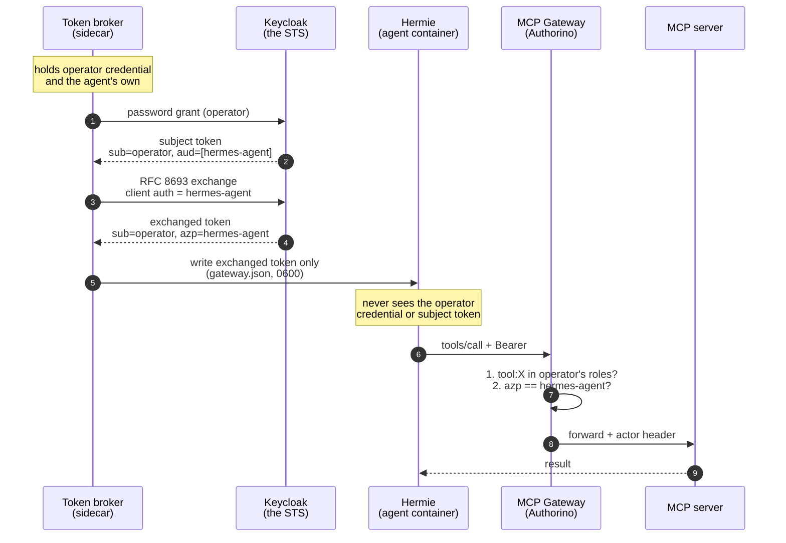
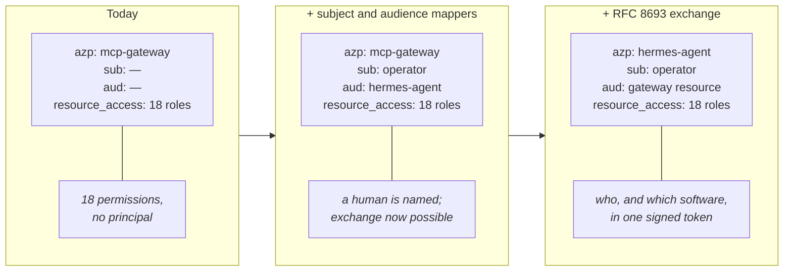
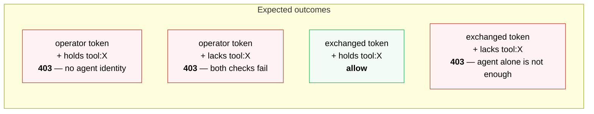

# 02 — Target architecture

Three principals where there is one today, bound into a single verified token, enforced as an
intersection at the MCP Gateway, and stamped onto everything downstream.

## The principals

| Principal | What it is | How it authenticates |
|---|---|---|
| `operator` | The human persona. One per tenant — the lab has no per-attendee login and will not grow one. | Password grant, acquired and refreshed automatically by the broker. No participant action, ever. |
| `hermes-agent` | Hermie itself. The software acting on the operator's behalf. | Confidential Keycloak client. Secret initially; SPIFFE-attested later ([05](05-spiffe-and-ztwim.md)). |
| `attack-runner` | The probe engine. | Its own realm user, so attack traffic stops being indistinguishable from the operator's. |

The workload ServiceAccount stays what it is — the MLflow writer — and is not an identity for
tool calls.

## Diagram 2 — the broker and the exchange

The key structural move: **the component that holds the operator's credential is not the agent.**
That separation already exists physically — `MCP_USERNAME`/`MCP_PASSWORD` live on the
`mcp-token-refresh` sidecar, and the `hermes` container only ever reads the token file. This design
gives that split a purpose.



Two properties worth naming:

- **The agent cannot mint its own authority.** It reads a file. It cannot obtain a token for a
  subject nobody authenticated, and it cannot widen its own scope.
- **The operator's credential never enters the agent's process.** Today it does not either — but
  today that buys nothing, because the token it produces names nobody.

## Diagram 3 — what the token says, in three stages

This is the whole argument in one picture.



Stage 2 is a prerequisite, not a nicety: Keycloak's standard token exchange requires the
requesting client to be the subject token's `azp` or appear in its `aud`, and today it is neither.

## Why both facts must be in one token

A tempting alternative is to validate two credentials at the gateway — the operator's token *and*
the agent's SVID — and require both. **Authorino cannot express that.** Its `authentication` rules
are **OR**, not AND: multiple `jwt` rules mean "any one of these identities succeeds". There is no
way to say "a valid operator token *and* a valid agent credential" inside one AuthPolicy.

Getting both facts cryptographically bound into one verified identity is exactly what the token
exchange buys. This is the load-bearing reason for the design, not a stylistic preference.

A genuine cryptographic AND *is* available as a fallback, by chaining the two listeners the gateway
already has: `mcp` (public) validates the agent's JWT-SVID from a custom header, `mcps` (internal)
validates the operator's token from `Authorization`. Both hops must pass, so both identities must
be valid, and they are independently rooted — one in SPIRE, one in Keycloak. It is architecturally
cleaner in one respect and worse in another: the two facts are never bound together in a single
artifact, so nothing downstream can be handed "the pair" as one verifiable thing. Keep it in
reserve for the case where Keycloak will not accept a SPIFFE credential
([05](05-spiffe-and-ztwim.md)).

## Diagram 4 — the intersection rule

Added to `mcp-authz-policy`'s existing `tool-access-check` as a second predicate. Predicates
within a `patternMatching` block are AND-ed, and multiple `authorization` rules are also AND-ed,
so this composes with what is already there:

```cel
has(auth.identity.azp) && auth.identity.azp == 'hermes-agent'
```

The resulting truth table is what distinguishes *intersection* from *substitution* — and the
bottom-right cell is the one that proves it:



Row 4 is the point. An agent identity does not grant anything on its own; it only qualifies
*how* the operator's permissions may be used. That is Uber's "evaluate both the personnel identity
and the agent identity simultaneously", expressed in the one place this lab already enforces
policy.

Row 1 also matters operationally: it means a raw operator token stops working once the rule is
enforced. That is the intended security property, and it is also why enforcement must be behind a
per-tenant flag until the broker is proven — see [07-phasing.md](07-phasing.md).

## Why the agent client's secret is defensible

`automation/gitops/tenant-platform/templates/mcp-gateway.yaml:199-202` records why a confidential
agent client was removed once already:

> "the confidential wp-dev/hermes-agent client is gone: its secret could not live in git, and
> Hermes authenticates as the realm's operator user anyway, so its tool scope is capped at the
> operator persona rather than a full-access service account."

Two things answer that objection.

**`serviceAccountsEnabled: false`.** The new client has no service account, so it cannot obtain a
token in its own name. It can do exactly one thing: re-mint a token whose subject *someone else*
already authenticated, with no more permissions than that subject had. Its secret therefore grants
strictly **less** than the `operator`/`operator` password already printed in the lab guide. It can
sit in `values.yaml` beside `adminPassword: redhat` without reopening the hole the old client
opened — and the comment should be rewritten to say so, because that comment is the design record
future readers will trust.

**The sanctioned secret channel exists anyway.** `MODEL_API_KEY` and `API_SERVER_KEY` already reach
a tenant through the catalog item's `ocp4_workload_gitops_bootstrap_helm_values` →
`bootstrap-tenant/templates/hermes-env-secret.yaml`. A client secret can travel the same path and
never touch git. (Chart-generated secrets remain impossible: Helm's `randAlphaNum` re-rolls on
every render and ArgoCD renders client-side, so a generated value would rewrite the Secret on every
sync and restart the agent mid-exercise.)

Either way, the secret is an interim measure. The target is a SPIFFE-attested credential with
nothing to distribute at all.

## What the exchange must and must not request

**Do not pass `audience=` on the exchange request.** Requesting an audience re-scopes which
client's protocol mappers apply, which risks dropping `resource_access` — and `resource_access` is
the operator's entire permission set. Per-hop audience scoping should come instead from a fixed
`oidc-audience-mapper` on the `hermes-agent` client, naming the gateway resource already declared
in `MCPGatewayExtension.spec.oauthProtectedResource.resource`. Same property, none of the risk.

**The `roles` scope is load-bearing.** The `resource_access.${client_id}.roles` mapper lives in the
realm's custom `roles` client scope. If `hermes-agent` does not carry that scope, the exchanged
token has no `resource_access` and every tool call fails the *first* predicate — a confusing
failure that looks like a policy bug rather than a scope omission.

**Fail closed.** If the exchange fails, the broker must log loudly and write nothing. It must never
fall back to the raw operator token: that would silently de-identify the agent at exactly the
moment the policy started requiring identity, and the symptom would surface as the already
documented "Hermes reports a network issue" confusion.

## What this design deliberately does not change

- **No participant login.** The operator identity is acquired server-side and refreshed on a loop,
  exactly as the agent's token is today. Nothing is added to the participant's path.
- **Enforcement stays at the MCP Gateway.** The MCP servers and plant-api continue to make no
  authorization decisions. They gain the ability to *record* an actor, not to judge one.
- **Module 3's exercise still works.** Revoking a `tool:` role from the operator in Keycloak still
  produces a 403, because the first predicate is untouched. The identity work adds a second
  condition; it does not replace the first.
- **The participant-editable surface keeps its shape.** New rules go *inside* the two AuthPolicies
  that already carry `rhdp.redhat.com/editable: "true"` and are named by `resourceNames` in
  `bootstrap-tenant/templates/rbac.yaml:48-51`. No third policy object the participant cannot patch.
