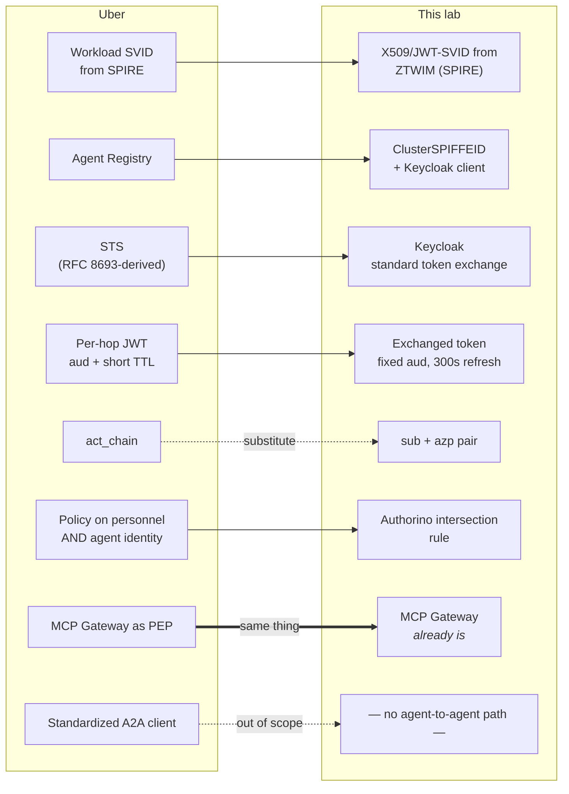

# 03 — Mapping Uber's model onto this stack

[Uber's post](https://www.uber.com/us/en/blog/solving-the-agent-identity-crisis/) describes a
production system at a scale this lab does not have. The useful exercise is not to copy it but to
find which of its primitives this stack can carry honestly — and to be explicit about the ones it
cannot.

## Diagram 5 — primitive by primitive

Dashed edges are substitutions, not equivalences.

## The table

| Uber primitive | Our implementation | Fidelity |
|---|---|---|
| Workload SVID from SPIRE, proving "the legitimacy of the underlying compute environment" | X509-SVID / JWT-SVID from **Zero Trust Workload Identity Manager** (Red Hat's SPIRE), via the SPIFFE CSI driver | **Faithful.** Same project, Red Hat supported. See [05](05-spiffe-and-ztwim.md). |
| **Agent Registry** — "the source of truth, storing this registration", mapping `agent_id` to authorized workloads | `ClusterSPIFFEID` (which workload may hold which SPIFFE ID) plus the `hermes-agent` Keycloak client | **Good.** Two objects rather than one registry, but the property — an agent cannot claim an identity its workload is not authorized for — holds. |
| **STS** performing token exchange | Keycloak's standard token exchange V2 (RFC 8693), verified advertised on this realm | **Faithful in mechanism**, with one gap: see `act_chain` below. |
| Per-hop token: "a specific Audience claim and a short time-to-live in the order of minutes" | Exchanged token with a fixed `oidc-audience-mapper` naming the gateway resource; broker refreshes every 300s | **Partial.** The audience is per-destination and correct. But the lab has exactly one downstream hop, so "per-hop" is unexercised — there is no second audience to get wrong. Also: Authorino's JWT authentication does not itself enforce `aud`, so the audience is narrative and defence-in-depth rather than an enforced boundary. |
| **`act_chain`** — "every participant in the lineage […] rather than just the immediate caller", nested, each entry with its own `sub` and `iat` | The **`sub` + `azp` pair**: `sub` = operator, `azp` = `hermes-agent` | **A substitute, and the documents must say so.** Two flat claims expressing two hops. Not nestable, not recursable, and nothing signals to a verifier that they form a chain. See [04](04-keycloak-upgrade-path.md). |
| Policy evaluating "both the personnel identity (the human initiator) and the agent identity (the acting logic) simultaneously" | Authorino intersection rule: operator holds `tool:X` **AND** `azp == hermes-agent` | **Faithful.** This is the clearest one-to-one match in the whole mapping, and it lands in the component the lab already uses as its policy enforcement point. |
| **MCP Gateway** as "a policy enforcement point for MCP tool invocations", enforcing "tool access checks and redaction of sensitive data" | MCP Gateway with Kuadrant AuthPolicies | **Already identical.** Tool access checks are in place today; redaction is not, and is not proposed here. |
| Full contextual attribution for audit | Authorino-injected actor header, threaded by `jti` into plant-api's audit, work orders, and MLflow trace tags | **Faithful in shape**, newly built. See [06](06-provenance.md). |
| **Standardized A2A client** automating "the STS JWT exchange and propagation of the actor chain" | Nothing | **Out of scope.** This lab has one agent and no agent-to-agent path. Inventing one to demo a deeper chain would be building a feature to justify a claim. |
| Lifecycle: registration via the Michelangelo platform; short TTLs instead of explicit revocation | GitOps-provisioned per tenant; realm roles revocable in the admin console (module 3's exercise) | **Different but adequate.** The lab's lifecycle is "a tenant is created and destroyed", which is a cleaner revocation story than Uber's. |

## What this stack does better

Worth noting, because the mapping is not purely a story of compromise.

**The credential-mediation pattern is already taught.** Module 2 has participants create a sandbox
with `--provider maas`, and OpenShell puts an opaque placeholder in the sandbox environment while
swapping in the real model key at the egress proxy. The agent authenticates to the model perfectly
well and never holds the credential. That is the same principle as Uber's STS, already working,
already in the lab guide, and already understood by participants by the time identity would be
introduced. The broker design extends a pattern rather than importing one.

**Revocation is observable in seconds.** The bridge polls the operator's Keycloak role mappings
every 5s and restarts the agent on change (`bridge-supervisor.sh`, `roleWatch`). Uber relies on
short token TTLs and describes no explicit revocation mechanism.

## What we cannot reproduce, and will not pretend to

1. **A nested actor chain.** Needs Keycloak 26.8+ with a preview feature on a Keycloak we do not
   own. The `sub`+`azp` pair is honest for two hops and dishonest if described as `act_chain`.
2. **A third hop.** There is no sub-agent, so there is no lineage to record beyond human → agent.
   This is a property of the lab, not a limitation of the design.
3. **Cryptographic binding of the agent's *workload* attestation into the tool-call token.** The
   exchanged token proves "the agent client authenticated"; with SPIFFE it additionally proves
   "the agent client authenticated using a credential only the attested workload could hold". That
   is one inference step short of the SVID itself being inside the token. Uber has the same step.
4. **Redaction at the gateway.** Uber's MCP Gateway redacts sensitive data in responses. Not
   proposed here, and arguably in tension with the lab's deliberate-insecurity baseline.

## The one framing this lab adds

Uber's post is about a production system where the identity model was wrong. This lab's value is
showing *why* it was wrong, on a system small enough to hold in your head — and the live token is
the artifact that does it. Before: 18 permissions, no principal. After: the same 18 permissions,
one human, one agent, one audience. Nothing about the agent's code changed in between.

That is the lab's existing thesis — "every exercise is a change to infrastructure configuration,
never to agent source" — applied to identity.
