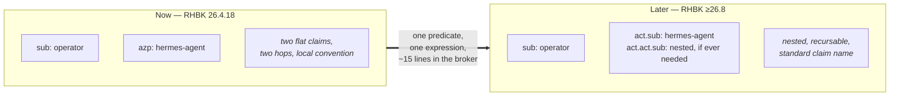

# 04 — Keycloak: FGAP, versions, and the road to a real `act` claim

Two questions this answers: **what is FGAP**, and **can we just upgrade and turn delegation on?**

## What FGAP is

**FGAP = Fine-Grained Admin Permissions.** It is Keycloak's model for delegating *scoped*
administrative rights — "may manage these clients", "may view these users", "may assign roles in
this group" — instead of the all-or-nothing `realm-admin` role. V2 is a rewrite built on
Keycloak Authorization Services, with a single Permissions section in the admin console.

It matters here for one specific reason: **RFC 8693 delegation is gated exclusively through FGAP
V2**, using the new `delegate` scope on the Users resource type (and `delegate-members` on Groups).
So the question "may this agent act on behalf of this user?" is itself an FGAP authorization
decision — which is a pleasing conceptual fit for a lab about agent authority, and worth saying out
loud if this ever reaches the lab guide.

**Status on our cluster: available, currently off.**

```
realm waterplant-user-9c5ls: adminPermissionsEnabled: false
```

The field exists, which means the per-realm toggle is present. FGAP V2 has been GA and enabled by
default at the server level since Keycloak 26.2, and is turned on per realm under
Realm Settings → Admin Permissions. **FGAP is not a blocker.**

Do not confuse it with FGAP **V1**, which is the one still in preview behind
`--features=admin-fine-grained-authz:v1`. V1 is needed only for *legacy* (V1) token exchange, which
we are not using. V2 does not support V1-style token exchange permissions, and vice versa.

## The actual blocker

| Requirement | Needs | Have |
|---|---|---|
| Standard token exchange V2 (RFC 8693) | Keycloak 26.2+, on by default, per-client `standard.token.exchange.enabled` | ✅ 26.4.18, and `urn:ietf:params:oauth:grant-type:token-exchange` is advertised on the realm |
| FGAP V2 | Keycloak 26.2+, per-realm toggle | ✅ available, off |
| **Delegation** (`actor_token`, `act` claim) | **Keycloak 26.8+** *and* preview feature `token-exchange-delegation` *and* FGAP V2 | ❌ |

So everything in the target design works today **except** the nested `act` claim.

## Can we upgrade?

Three reasons not to, in increasing order of importance.

**1. There is no Red Hat build at 26.8 yet.** RHBK 26.4.z maps 1:1 to upstream Keycloak 26.4.z, and
RHBK tracks only even-numbered upstream minors — 26.0, 26.2, 26.4, 26.6. The RHBK default has
already moved to the **26.6** stream. Upstream 26.8 is even, so an RHBK 26.8 is plausible as a
future baseline, but it does not exist now.

**2. `token-exchange-delegation` is a preview feature.** The lab's standing rule is "pin every
version, no automatic upgrades", and its non-GA components are declared in
`publishing-house/spec.yaml` under `non_ga_products` with an access plan. Adding a preview
*Keycloak* feature is not out of character for this lab — but it is one more unsupported surface
under the component everything else authenticates against.

**3. We do not own that Keycloak.** This is decisive. It is RHDP-provisioned in namespace
`keycloak` with `features: null`, and it serves realm `sso` plus all three `waterplant-*` realms.
Patching its image or feature flags changes shared cluster infrastructure for every tenant and for
the RHDP platform itself. The realm imports have to live beside that CR
(`bootstrap-infra/templates/argocd-project.yaml` whitelists the destination for exactly that
reason), so we are a tenant of it, not its owner.

### The rejected option: a lab-owned Keycloak

We could deploy a second Keycloak — upstream 26.8+, our namespace, our feature flags — and use it
only for the agent-identity realm. It would give a genuine `act` claim today.

**Rejected.** A Red Hat workshop whose headline identity story runs on a community build with a
preview feature enabled is a worse artifact than one that runs on the supported product and is
honest about a two-hop limit. It also doubles the identity providers in a lab that already has
seven modules, and it would mean module 3's Keycloak exercise and the identity module pointed at
different servers.

Recorded here so it is a decision rather than an omission.

## What RHBK ≥26.8 would buy



Concretely: a standard claim name other verifiers already understand; arbitrary nesting depth if a
sub-agent ever appears; and each entry carrying its own `iat`, so the chain records *when* each
delegation happened rather than only who was involved.

## Making the switch cheap — the one decision to take now

The cost of moving later is small, **provided the actor is modelled as an ordered list from day
one**.

| Component | Change when moving to `act` | Size |
|---|---|---|
| Broker (`mcp-token-refresh.py`) | obtain an agent token, pass `actor_token` + `actor_token_type` | ~15 lines |
| AuthPolicy predicate | `auth.identity.azp == 'hermes-agent'` → nested `act.sub`. Authorino already does nested claim access for `resource_access`, so this is mechanical | 1 line |
| Provenance header CEL | populate the actor list from `act` instead of from `sub`+`azp` | 1 expression |
| Keycloak realm | enable FGAP V2; grant the `delegate` scope on Users to the actor client | a few REST calls / import entries |
| Keycloak itself | RHBK ≥26.8 + preview feature, on a CR we do not own | the real gate |

**So: represent the actor as an ordered list everywhere downstream, even while it only ever holds
two entries.** The injected header, plant-api's verified-actor field, and the MLflow trace tag must
all be chain-shaped from the start. Then the switch changes only where the list is *populated
from*, and nothing downstream moves.

Model it instead as two scalar fields — `subject` and `agent` — and the same switch means changing
the plant-api schema, the trace tag format, the header parser, and every QA assertion that reads
them. Same destination, an order of magnitude more work. Choosing the list costs nothing today.

## One posture change to anticipate

Delegation requires an `actor_token`, which means the agent client must be able to authenticate as
*itself* — so `serviceAccountsEnabled` has to flip to `true`. That weakens the argument in
[02](02-target-architecture.md) for why the client secret is defensible: a client with a service
account *can* act in its own name, and its secret then grants something standalone.

This is not a blocker, but it does mean the two changes should land together: by the time
delegation is available, the agent's credential should be SPIFFE-attested rather than a string in
`values.yaml`. That is [05](05-spiffe-and-ztwim.md), and it is the better reason to do it.

## Also worth knowing: two client-auth methods are available

From the live realm's discovery document:

```
token_endpoint_auth_methods_supported:
  [private_key_jwt, client_secret_basic, client_secret_post, tls_client_auth, client_secret_jwt]
```

`private_key_jwt` and `tls_client_auth` are both present, and both are routes to authenticating the
agent client with a SPIFFE credential instead of a secret. Which one fits better is discussed in
[05](05-spiffe-and-ztwim.md) — the short version is that `tls_client_auth` with an X509-SVID may be
the more natural binding, and it is the option the earlier drafts missed.
