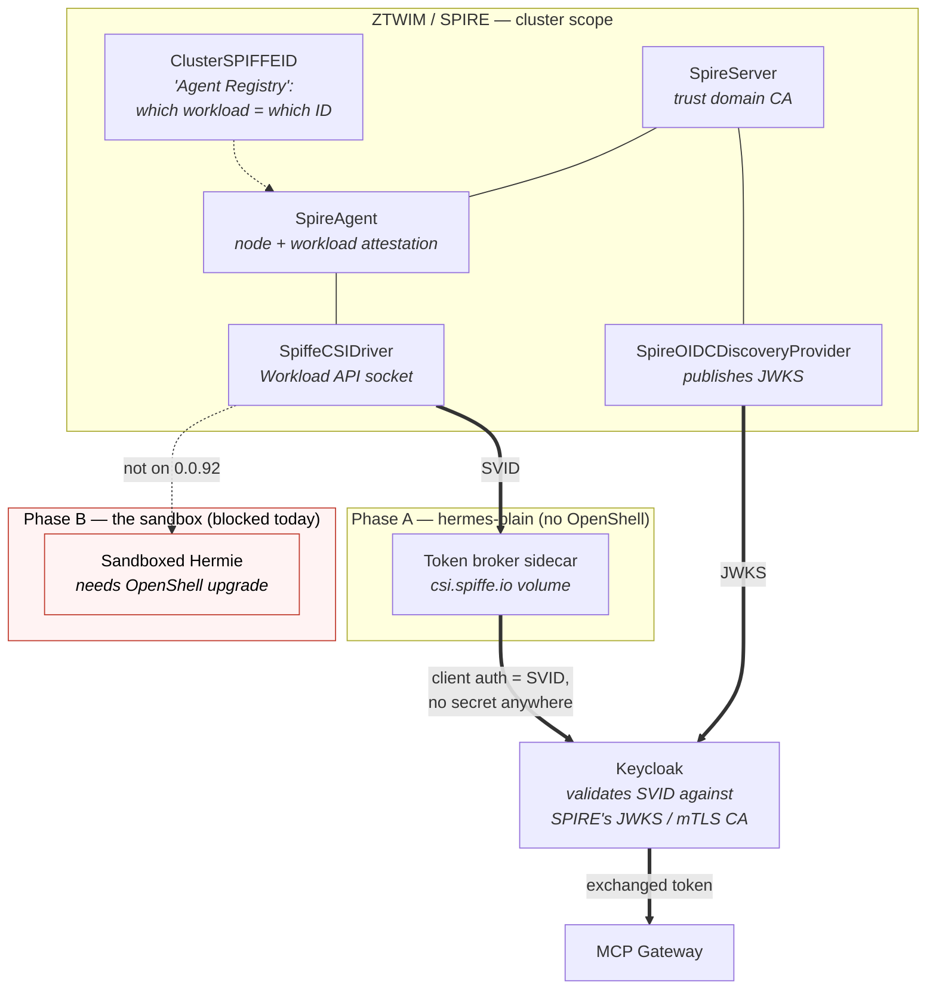

# 05 — Attested workload identity: ZTWIM, SPIFFE, and why OpenShell is off the critical path

The client secret in [02](02-target-architecture.md) is an interim measure. The target is a
credential the agent cannot copy, cannot leak into a config file, and does not have to be
distributed at all — because it is issued to the workload on the basis of attestation.

This is Uber's first step ("every workload first fetches its own cryptographically signed workload
SVID… this proves the legitimacy of the underlying compute environment"), and Red Hat ships the
product for it.

## Zero Trust Workload Identity Manager

Red Hat's SPIFFE/SPIRE operator. Verified available in this cluster's catalogue and **not
installed**:

```
packagemanifest: openshift-zero-trust-workload-identity-manager
  catalog:         redhat-operators / Red Hat Operators
  default channel: stable-v1
  CSV:             zero-trust-workload-identity-manager.v1.1.3
  support:         Red Hat, Inc.
  install modes:   OwnNamespace, SingleNamespace, AllNamespaces
  CRDs owned:      ZeroTrustWorkloadIdentityManager, SpireServer, SpireAgent,
                   SpiffeCSIDriver, SpireOIDCDiscoveryProvider,
                   ClusterSPIFFEID, ClusterFederatedTrustDomain

oc get crd | grep -iE 'spire|spiffe'   ->   (nothing)
```

Two of those CRDs are the pivots for this design:

- **`ClusterSPIFFEID`** declares which workloads may hold which SPIFFE ID. This is the
  Agent Registry equivalent — the thing that stops one workload claiming another's agent identity.
- **`SpireOIDCDiscoveryProvider`** publishes a standard OIDC discovery document and JWKS for the
  trust domain. That is what lets a system *outside* SPIFFE — Keycloak, here — verify an SVID
  without understanding SPIFFE at all.

Installation follows the strict convention in `bootstrap-infra/templates/operators.yaml`:
`installPlanApproval: Manual`, an explicit `startingCSV`, declared `dependencies`, and a sync
`wave`. The InstallPlan approver refuses any plan containing a CSV that is neither pinned nor
listed, so the pin and dependency list must be exact.

## Diagram 6 — the target, and the path to it



**Do Phase A first, and possibly only Phase A.** A plain Deployment with a `csi.spiffe.io` volume
and a `ClusterSPIFFEID` is far simpler than going through OpenShell, and it isolates the Keycloak
question (will it accept an SVID as client auth?) from the OpenShell question entirely. The
console already targets `hermes-plain` at baseline, so this is the live path, not a side quest.

## Why OpenShell is off the critical path

The newer OpenShell documentation describes exactly what we would want: a provider profile with
`grant_type: token_exchange`, `client_assertion_type: urn:ietf:params:oauth:client-assertion-type:jwt-spiffe`,
and a `subject_token` sourced from another provider credential — the supervisor fetches a JWT-SVID
from the local Workload API, the gateway brokers an intermediate token with its own SVID, and the
sandbox never receives either credential. That is this entire design, implemented natively.

**It is not in the deployed build.** The vendored chart is `helm-chart-0.0.92.tgz`, the CLI is
`0.0.88`, and the documentation describing those features is for **v0.1.9**. Verified live:

```yaml
# openshell provider profile export deepinfra -o yaml   (a builtin, this build)
credentials:
- name: api_key
  env_vars: [DEEPINFRA_API_KEY]
  auth_style: bearer
  header_name: authorization
endpoints: [...]
binaries: [...]
```

No `token_grant`. No `refresh.strategy`. No `client_assertion_type`. No `subject_token`. The
profile schema on this build is **static-credential only**.

The chart does carry `server.providerTokenGrants.spiffe.{enabled,workloadApiSocketPath}`, but
enabling it renders exactly one config key (`provider_spiffe_workload_api_socket_path`), the
chart's own unit test asserts `[openshell.gateway.spiffe]` is *not* rendered, and the StatefulSet
mounts no SPIFFE volume. `openshell provider create` does expose `--runtime-credentials`, but there
is no profile schema on this build to drive it.

So: **extending SPIFFE into the sandbox requires an OpenShell upgrade** (0.0.92 → ~0.1.9, plus a
matching CLI — `openshell-cli:0.1` ≙ v0.0.88 is the verified pair today, and
`tenant-openshell/values.yaml` notes that the tags must stay in step). That upgrade touches the one
component modules 2, 4 and 5 are built on, so it is its own project with its own re-verification.
It should not gate the identity work.

## The open question: how does Keycloak verify an SVID?

Two candidate bindings, both advertised by the live realm.

### Option 1 — `tls_client_auth` with an X509-SVID *(probably the better fit)*

SPIRE's primary credential is an **X509-SVID**, delivered by the CSI driver as a rotating
certificate and key. Keycloak supports mTLS client authentication (`tls_client_auth`), where the
client proves itself with a certificate rather than a secret or an assertion.

Why this may be cleaner: no claim-shape negotiation. The SPIFFE ID lives in the certificate's URI
SAN, Keycloak matches the client by its configured subject DN or SAN, and nothing has to agree
about `iss` or `sub` semantics. It also uses SPIRE's native credential rather than its secondary
one.

Why it may not work here: Keycloak's mTLS client auth needs the TLS connection to terminate
somewhere that can present and validate client certificates, which on OpenShift means the route or
a sidecar must be configured for it, and the RHDP Keycloak's ingress is not ours to reconfigure.
**This is the first thing to test**, and it was missed in earlier drafts.

### Option 2 — `private_key_jwt` with a JWT-SVID

The broker fetches a JWT-SVID and presents it as a client assertion, with the Keycloak client
configured `clientAuthenticatorType: client-jwt`, `use.jwks.url: "true"`, and `jwks.url` pointing
at the `SpireOIDCDiscoveryProvider`.

The specific risk: OIDC's `private_key_jwt` expects the assertion's `iss` **and** `sub` both to
equal the `client_id`. A SPIRE JWT-SVID has `sub` = the SPIFFE ID and `iss` either absent or the
SPIRE OIDC issuer URL. The trick that may rescue it is **setting the Keycloak `clientId` to the
SPIFFE ID string**, so `sub == client_id` holds, with `aud` requested as the realm issuer. It
survives only if Keycloak tolerates a missing or non-matching `iss`. Unverified.

### Fallbacks, in order

1. **Two-listener cryptographic AND.** `mcp-auth-policy` on the public listener validates the
   JWT-SVID read from a custom header (Authorino's `authentication.credentials.customHeader`, with
   `issuerUrl` = the SPIRE OIDC discovery provider); `mcp-authz-policy` on the internal listener
   validates the operator's token. Both hops must pass, so both identities must be valid, and they
   are independently rooted. **No Keycloak client assertion involved at all.** The cost is that the
   two facts are never bound into one artifact — see [02](02-target-architecture.md). One unknown:
   whether the MCP broker forwards an unknown header between the two hops.
2. **Keep the secret; use the SVID as recorded provenance only.** The agent client stays
   secret-authenticated, and the SVID is captured into the actor chain as evidence of which
   workload acted. Weaker, but it still makes the attestation visible and it is a small change.

## What attestation actually buys this lab

Worth being precise, because "zero trust" is easy to say and hard to demonstrate.

With a secret, the gateway can prove: *a caller that knows the `hermes-agent` secret exchanged a
token the operator authenticated.* With an attested SVID, it can prove: *a caller running in a
workload the cluster attested to be Hermie, in this namespace, under this ServiceAccount, did so.*

The difference is exactly the thing module 2 already teaches about the model key — the agent
authenticates successfully while holding nothing it could leak. Identity would become the second
instance of a pattern participants have already met, which is the strongest argument for doing it
this way rather than with a longer-lived secret.

It also closes the objection that removed the original agent client: with attestation there is no
secret to keep out of git, because there is no secret.
