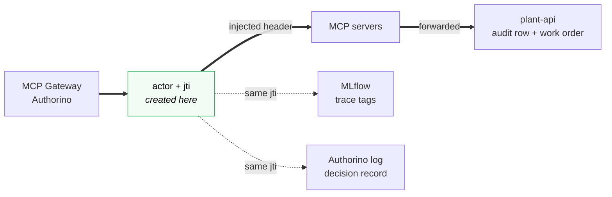

# 06 — Provenance: making the evidence layer answer "who asked?"

> **SUPERSEDED IN PART — read [13-tool-path-components.md](13-tool-path-components.md) first.**
>
> The *goal* of this document stands, and so does the actor chain it specifies. **How the actor is
> delivered has changed completely**, because the route described below does not scale: it routed
> the actor through the three MCP servers' `client.py`, and we may not own every MCP server, nor
> want to patch each one as servers are added.
>
> | This document says | What was actually built |
> |---|---|
> | MCP servers read `x-waterplant-actor` and forward it ("Route A") | **Nothing in any MCP server changes.** The gateway's Envoy emits the actor as an OTLP span |
> | `raised_by_verified` beside `raised_by` in plant-api | **Dropped.** The gateway is not on the server→plant-api hop, so it cannot be reached without the server change above |
> | `GET /audit` and an actor on control actions | **Dropped**, same reason |
> | `ui/traces.py` gains `tag_trace()` | **Dropped.** The console never sees the verified actor; anything it wrote would be self-asserted |
> | `jti` is the join key | **Wrong** — corrected in place below. `jti` identifies the token; `x-request-id` identifies the call |
>
> **Zero images are needed for what shipped.** Everything is chart configuration plus one sidecar
> built from images already pulled on the cluster.


Identity at the gateway solves authorization. It does not by itself solve attribution — and
attribution is what this lab actually runs on. Every module from 1 to 6 asks participants to prove
something from a trace, a tool result, or plant state. None of those records a principal today.

This is Uber's second problem: "execution context (originating user, intermediate agents) is
dropped across agent hops."

## The target

One value, created once, at the only place that has verified both principals — the gateway — and
carried from there into every durable record.



**Correction, measured 2026-11-27: `jti` is not the join key.** The original design said it was —
"the token's unique id, already present in today's token" — and that reasoning only holds if a
token is minted per call. It is not. OpenShell caches the exchanged token (`token_grant`
`cache_ttl_seconds`), so every tool call inside that TTL carries the **same** `jti`. Two separate
console turns calling two different tools (`get_reservoir_level`, `get_pump_status`) produced
byte-identical `jti` values and different `x-request-id` values.

So the two identifiers divide the work:

| Identifier | Scope | Use |
|---|---|---|
| `jti` | the **token** — stable across every call in its cache TTL | "which minted credential acted" |
| `x-request-id` | the **call** — Envoy generates one per request | the join key across gateway, server and trace |

`x-request-id` is what turns separate logs into an audit trail. `jti` still earns its place beside
it: it ties a burst of calls back to one exchange, which is exactly what you want when asking
whether an agent re-authenticated between two actions.

## Measured on the cluster, 2026-11-27 — two findings that change this document

Two assumptions in the original draft were tested on tenant `user-gngp7`. One holds; one was
wrong, and the wrong one narrows the design in a useful way.

### 1. The injected header does reach the MCP server — but this was not a given

The gateway's data plane is the **Kuadrant wasm-shim**, not native Envoy `ext_authz`
(`EnvoyFilter/kuadrant-mcp-gateway` loads `kuadrant-wasm-shim` from `kuadrant-operator-wasm`).
Native `ext_authz` applies `ok_response.headers_to_add` for free; the shim is a separate
implementation, so "Authorino emits it" and "the upstream sees it" are two different claims.

The deployed shim is **0.14.2** — `RELATED_IMAGE_WASMSHIM` on the kuadrant operator points at
`rhcl-1/wasm-shim-rhel9`, and the served `plugin.wasm` carries `service.version 0.14.2` in its
OpenTelemetry resource attributes. Our gateway's filter config uses the **legacy `actionSets`
schema**, which that shim runs through `src/configuration/legacy_translation.rs`
(`build_auth_on_reply`). It builds, in order:

| Predicate | Operation |
|---|---|
| `has(auth.denied_response)` | Deny, terminal |
| `ok_response.response_headers_to_add / headers_to_remove / query_parameters_*` non-empty | **Fail, terminal** — logs `Unsupported field in OkHttpResponse` |
| `has(ok_response) && has(dynamic_metadata)` | Store as `auth` dynamic metadata |
| `has(ok_response)` | **`Operation::Headers(target: Request, headers: ok_response.headers)`** |

Authorino populates `response.success.headers` into `OkHttpResponse.headers` — the fourth row. So
it is injected into the request forwarded upstream. **Route A is viable.**

**The sharp edge, worth carrying forward:** the second row means the shim does *not* silently
ignore fields it cannot implement — it **fails the request closed**. Authorino does not expose
`response_headers_to_add` for success responses, so this configuration is safe, but anyone adding
to this block should not assume an unsupported extra would be harmlessly dropped. The deployed
`plugin.wasm` contains that exact log string, so this is our binary and not merely upstream source.

**Resolved 2026-11-27 — now observed on the wire, not merely argued from source.** An EnvoyFilter
added a gateway access-log format reading the header, and a real console turn produced:

```
WATERPLANT-ACTOR ts=2026-11-27T12:24:19.649Z reqid=3cd9015f-d7f8-4bbf-822b-5bf250f87791
  authority=telemetry-mcp.mcp.local tool=get_reservoir_level
  server=user-gngp7-agentops/telemetry-mcp mcpmethod=tools/call
  actor={"chain":[{"role":"subject","sub":"operator"},
                  {"role":"agent","sub":"spiffe://agentops.lab/ns/user-gngp7-agentops/sa/user-gngp7-openshell-sandbox"}],
         "jti":"ntrtte:1f313fd7-..."} status=200 dur=17
```

Both principals, the tool, the server and the decision — at the gateway, with no code in any MCP
server. See [13](13-tool-path-components.md) for the full path analysis.

### 2. Only `tools/call` crosses the gateway — everything else bypasses it entirely

This one was wrong in the original draft, and it matters.

A throwaway MCP server was registered on the tenant and logged every request it received. **Every**
broker request arrived as:

```
Host: hdr-echo.user-gngp7-agentops.svc.cluster.local:8080
User-Agent: mcp-broker
Gateway-Server-Id: user-gngp7-agentops/hdr-echo:hdrecho_:echo.mcp.local
```

— straight to the ClusterIP Service, **not** through the gateway. That covered `initialize`,
`ping`, `tools/list` and the GET SSE stream. None of them carried any `x-mcp-*` header, and none
of them passed through the `mcps` listener or its AuthPolicy.

Consequences for this design:

- **The actor header can only ever appear on `tools/call`.** That is the right scope — provenance
  attaches to actions, not to protocol chatter — but it must be stated, not assumed.
- **Every consumer must treat the header's absence as normal**, not as an error or as a tampering
  signal. An MCP server that rejects a request without `x-waterplant-actor` would break its own
  discovery.
- The policy's `anonymous` authentication rule is therefore doing less than it appears to: the
  protocol traffic it was written for does not reach the gateway from the broker at all.
- It also means **the MCP servers' own health and discovery path is unauthenticated by
  construction** — a fact about the lab's architecture worth knowing independently of provenance,
  though not a new exposure (the Service is namespace-local and covered by the NetworkPolicy).

## Where the actor is created

Authorino can inject a computed value into the upstream request. On the **internal `mcps`
listener**, because that is the last hop before the MCP server and it is where both principals have
been verified:

```yaml
response:
  success:
    headers:
      x-waterplant-actor:
        plain:
          expression: >
            '{"chain":[' +
              '{"role":"subject","sub":"' + (has(auth.identity.preferred_username)
                 ? auth.identity.preferred_username
                 : (has(auth.identity.sub) ? auth.identity.sub : 'anonymous')) + '"},' +
              '{"role":"agent","sub":"' + (has(auth.identity.azp)
                 ? auth.identity.azp : 'none') + '"}' +
            '],"jti":"' + (has(auth.identity.jti) ? auth.identity.jti : '') + '"}'
```

Three things about that expression:

- **It emits a list, not two fields.** This is the decision from
  [04](04-keycloak-upgrade-path.md): when a real `act` claim becomes available, only this expression
  changes — it walks `act` instead of reading `sub` and `azp`. Every consumer downstream is
  untouched. Modelling it as `subject=…;agent=…` would make that a schema migration.
- **`has()` guards are mandatory.** The `anonymous` authentication rule leaves `auth.identity`
  empty for protocol traffic (`initialize`, `tools/list`, pings), and an unguarded field access is a
  CEL error, not an empty string.
- **`preferred_username` is preferred over `sub`.** A UUID in an audit row is useless to a
  participant reading it. Whether `sub` is even available is an open question — see
  [08](08-open-questions.md) — and the expression degrades gracefully either way.

## How the MCP servers receive it — a better option than expected

Phase 0 turned up something the earlier design missed. The three MCP servers run **mcp 2.x**, which
has a first-class identity surface:

```
mcp.server.request_state exposes: get_access_token, authenticated_principal,
                                  principal_components, ServerRequestContext
mcp.server.auth                 also present
```

So there are two routes, and they imply different things:

| Route | Mechanism | Trade-off |
|---|---|---|
| **A. Injected header** | Read `x-waterplant-actor` from the request, forward it to plant-api | The server records an opinion formed at the gateway. It verifies nothing and decides nothing — which keeps the lab's stated principle intact. |
| **B. Native SDK identity** | Configure a token verifier and read `authenticated_principal` / `get_access_token()` | More idiomatic and self-verifying. But it means the MCP servers validate tokens, which moves a security function into the application. |

**Recommend A.** Route B is tempting and more modern, but it contradicts the design record the lab
is built on:

> "Authorization belongs to MCP Gateway. Putting a check here would move enforcement into the
> application and defeat the point of the lab (§D8)."
> — `mcp-telemetry/src/telemetry_mcp/client.py:8-10`, byte-identical in all three servers

Route A records provenance without taking on enforcement. Route B is worth revisiting only if the
gateway turns out not to propagate the header (see [08](08-open-questions.md)) — in which case
reading the token the agent already sends is the natural fallback, and the servers would verify
without authorizing.

Note also that the servers run `stateless_http=True`, so there is no session to hang an identity
on; it must be per-request either way.

## Killing `raised_by: "unknown"` — the sharpest demo here

Today, `plant-api/src/plant_api/api.py:298`:

```python
raised_by: Annotated[str, Field(max_length=80, description="Identity of the requester.")] = "unknown"
```

An ordinary tool argument. **The model decides who raised the work order.** It defaults to
`"unknown"`, and the seeded records carry plausible human handles — `a.okafor`, `s.bramley` — so a
model-invented value is indistinguishable from a real one in the same column.

**Keep `raised_by` and add `raised_by_verified` beside it.** Do not overwrite it, and do not remove
the tool argument.

That is a deliberate choice. The pair is the teaching artifact:

| Field | Value | Meaning |
|---|---|---|
| `raised_by` | whatever the model wrote — perhaps `a.okafor` | What the agent *claimed* |
| `raised_by_verified` | `subject=operator; agent=hermes-agent; jti=…` | What the platform *established* |

An agent asserting a plausible human name next to a verified actor that says otherwise is the
entire lesson about self-asserted identity, visible in two columns of one record. Removing the
argument would hide it; overwriting it would erase the comparison. It also means the tool schema
the agent's SOUL was written against does not change.

## Control actions need an actor at all

Work orders at least have a field. Control actions have nothing: `set_pump_speed`, `start_pump`,
`stop_pump`, `set_valve`, `emergency_shutdown` each mutate state under a lock and return an
`ActionResult`, with no actor, no timestamp, and no log line anywhere in `plant-api`.

So "who stopped pump 4?" is currently unanswerable from the plant's own records. Proposed: a
bounded in-memory audit list on the same state object plant-api already holds, exposed as
`GET /audit`, with the actor chain and `jti` per entry. plant-api **stays single-replica**
(`strategy: Recreate`, state is an in-process object behind an asyncio lock), so this is one more
field on an object that is already the single source of truth — not new infrastructure.

## Traces

`ui/src/waterplant_ui/traces.py` already resolves a turn's trace id and already speaks the MLflow 3
API. Adding tags there — `waterplant.actor`, `waterplant.source` (`console` / `probe`),
`waterplant.jti` — gives traces a subject **without forking the pinned `hermes-otel` plugin**,
which is fetched by commit and sha256 in `hermes-openshell/Containerfile` and is the expensive
alternative.

It also replaces the current correlation method, which is comparing a casefolded 120-character
prefix of `request_preview` against the message the console sent. That works, and it is a clever
piece of engineering, but it is a heuristic standing in for an identifier. `jti` is the identifier.

## Making the probes distinguishable — and being honest about the limit

`plant_state.py:14-20` already specifies the fix:

> "Recommend a distinct `attack-runner` user rather than reusing `operator`: reusing it would make
> attack traffic indistinguishable from the participant's own in every trace they inspect, which is
> precisely what modules 4 and 5 are teaching them to tell apart."

**In scope and cheap:** an `attack-runner` realm user; probe turns tagged
`waterplant.source=probe`; the console's own direct plant-api calls attributed to it. That already
fixes the stated problem — the participant can tell the two apart in the evidence they are asked to
inspect.

**The honest limit:** probe tool calls reach the plant *through the same Hermes* as the human, and
Hermes holds one token file. So at the gateway, a probe's tool call and a human's are the same
identity, and no header trick changes that — there is no per-request identity reaching the agent.
Distinguishing them at the gateway would need a second agent instance (`hermes-probe`) with its own
broker running as `attack-runner`, which costs a pod against the participant's CPU quota and a
second stream of calls into a MaaS endpoint that already returns 429s under light load at 30
tenants. **Worth documenting as a stretch; not worth enabling by default.**

## What this does not fix

- **Retrieved content is still untrusted.** A compromised document inside an allowed path can still
  influence the agent. Provenance records that the agent acted; it does not judge why.
- **The agent can still misreport.** The SOUL says it never describes an action it did not take,
  and the trace is what proves otherwise. Provenance strengthens that, it does not replace it.
- **One human per tenant.** With no participant login, `subject` is a constant within a tenant. The
  value is in distinguishing *agent from human* and *probe from operator*, not one person from
  another.
