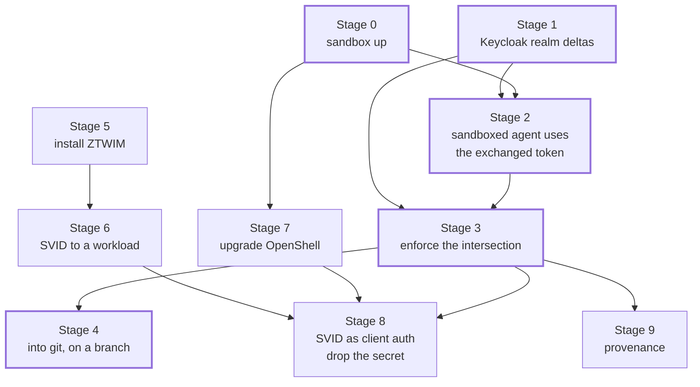

# 09 — Planned implementation

The runbook. Every stage states its **goal**, **preconditions**, **actions**, **how we verify it**,
**how we roll it back**, and **who does it** (me, or you for image builds). Stages are ordered by
dependency, not by importance.

Read [00-verification-findings.md](00-verification-findings.md) first — it is the evidence base, and
several steps below exist because of something found there.

## What changed since the earlier documents

Four things, all of which move steps around:

1. **Sandboxed Hermie first, not `hermes-plain`.** Reversing the recommendation in
   [05](05-spiffe-and-ztwim.md) and [07](07-phasing.md). Reason below — it is a better call than the
   one I made.
2. **The OpenShell upgrade and the ZTWIM install are in scope**, not deferred. They are the end
   state, so they are staged here with explicit dependencies rather than left as "later".
3. **Branching, chart changes and new images are in scope.** Earlier stages assumed live-only
   changes; that constraint is lifted. Image builds remain yours to run.
4. **The Kuadrant OTEL integration does not do what we hoped.** See
   [Stage 9](#stage-9--provenance-and-the-tracing-question).

### Why sandboxed first is the better call

`user-<id>-openshell` has `selfHeal: true, prune: true`, so the bridge ConfigMap is reconciled and a
live patch is reverted. **But the sandbox itself is not GitOps-managed at all** — no ArgoCD tracking
on any sandbox CR; the participant creates it imperatively.

So on the sandboxed path we change the agent's token by uploading into the sandbox: no selfHeal
fight, no chart release, no image rebuild. On `hermes-plain` the same step needs selfHeal suspended
or a new tag. Sandboxed is strictly easier *and* it is the real lab path.

The earlier "plain first" reasoning was about isolating the **SPIFFE** question, where OpenShell
0.0.92 is the blocker. That does not apply to the token exchange, which is one extra HTTPS POST from
the refresher to Keycloak — something OpenShell neither sees nor cares about. It still applies to
Stage 6, which is why Stage 6 stays on a plain Deployment.

## Cluster facts (re-read these; clusters get destroyed)

```
API              https://api.<cluster>.example.com:6443
apps domain      <apps-domain>
Keycloak         sso.<apps-domain>   (RHBK 26.4.18)
tenants          <user>, <user2>, <user3>           (3, not 4 — a 4th never provisioned)
chart tag        rh1-2027-lb1285-0.0.2  (pinned on every Application)
OpenShell        chart 0.0.92 · gateway ghcr.io/nvidia/openshell/gateway:0.0.92 · CLI 0.0.88
sandbox image    quay.io/rh-aiservices-bu/waterplant-hermes:0.2.7
ZTWIM            zero-trust-workload-identity-manager.v1.1.3 available · 0 SPIRE CRDs installed
```

**Test tenant: `<user>`. Leave the other two tenants untouched as controls.**

Two properties we exploit throughout:

- `targetRevision` is pinned **per tenant**, so one tenant's Applications can be repointed at a test
  branch while the others stay on the released tag. That is our isolated chart-change test.
- `user-<id>-policy` syncs `automated: {}` with selfHeal **off**, so a live AuthPolicy patch
  persists. (Verified on `0.0.1`; **re-verify on `0.0.2` before relying on it** — Stage 3 does.)

## Dependency order



**Stages 0–4 are the identity story and need neither ZTWIM nor an OpenShell upgrade.** Do them
first: if the exchange does not work on RHBK 26.4.18, everything downstream is moot and we will not
have upgraded anything to find out.

Stages 5 and 7 are independent of each other and of stages 0–4, so they can run in parallel with
them. Stage 7 is the highest-risk item in the whole plan.

---

## Stage 0 — Stand up a sandbox

**Goal.** A working sandboxed Hermie to change in Stage 2. None exists; the bridge is prepared and
waiting.

**Preconditions.** `hermes-openshell-bridge` Running; supervisor log shows "waiting for the
participant to start Hermes in sandbox hermie".

**Actions.** Module 2 verbatim, in the bridge's `cli` container. Read the sandbox image tag from
`tenant-openshell/values.yaml` rather than assuming `0.2.7` — it may have moved with chart `0.0.2`.

```sh
POD=$(oc get pod -l app.kubernetes.io/name=hermes-openshell-bridge -o name -n $NS)
oc rsh -n $NS -c cli $POD

openshell gateway add https://$USER-openshell.$NS.svc.cluster.local:8080 --local --name openshell-gw
openshell gateway select openshell-gw
openshell sandbox create --name hermie --from <sandbox image> \
  --cpu 2 --memory 4Gi --no-tty --provider maas -- true
openshell sandbox upload hermie /hermes /sandbox
openshell sandbox exec --name hermie -- start-hermes
openshell service expose hermie 8080 openai
```

Then the four network rules from module 2 — `mcp_gateway`, `keycloak_token`, `model_endpoint`,
`mlflow_tracing` — and point the console at the bridge:

```sh
oc set env deployment/water-plant-ui -n $NS AGENT_URL=http://hermes-agent.$NS.svc:8787
```

**Verify.** `openshell sandbox list` shows `Ready`; the console answers "What's the status of
pump 4?" with a figure matching the pump panel; a trace appears in the participant's MLflow
experiment.

**Rollback.** `openshell sandbox delete hermie`, and reset `AGENT_URL` to `hermes-plain`.

**Who.** Me.

---

## Stage 1 — Keycloak realm deltas

**Goal.** An agent identity that exists, and a subject in the token. Agent-agnostic — nothing here
knows which runtime consumes it.

**Preconditions.** Realm admin token (`admin`/`redhat` on `waterplant-$USER`).

**Actions.** Four REST calls. All additive.

1. `oidc-audience-mapper` on the `mcp-gateway` client → `included.client.audience: hermes-agent`,
   `access.token.claim: "true"`. **Without this the exchange returns
   `400 "Client is not within the token audience"`** — Keycloak requires the requesting client to be
   the subject token's `azp` or in its `aud`, and today it is neither.
2. `oidc-usermodel-property-mapper` on the same client → `user.attribute: username`,
   `claim.name: preferred_username`. This is where a subject first appears anywhere in the system.
   (A true `sub` comes from the `basic` scope, which the realm import replaced away.)
3. Create client `hermes-agent`: `publicClient: false`, **`serviceAccountsEnabled: false`**,
   `directAccessGrantsEnabled: false`, `standardFlowEnabled: false`, `fullScopeAllowed: true`,
   `defaultClientScopes: [roles, groups]`,
   `attributes: {"standard.token.exchange.enabled": "true"}`.
   - `roles` is **load-bearing**: the `resource_access.${client_id}.roles` mapper lives in that
     scope. Omit it and the exchanged token has no `resource_access`, and every tool call fails the
     *first* predicate — a confusing failure that looks like a policy bug.
   - `serviceAccountsEnabled: false` is what makes the secret defensible: the client cannot act in
     its own name, only re-mint a token someone else authenticated. See
     [02](02-target-architecture.md).
4. Fixed `oidc-audience-mapper` on `hermes-agent` naming the gateway resource (the value already in
   `MCPGatewayExtension.spec.oauthProtectedResource.resource`). **Do not pass `audience=` on the
   exchange request** — that re-scopes which mappers apply and can drop `resource_access`.

**Verify.**

```sh
# a: password grant -> aud now contains hermes-agent, preferred_username present
# b: exchange -> azp == hermes-agent, resource_access still 3 clients / 18 roles
curl -s -X POST "$ISS/protocol/openid-connect/token" \
  -d grant_type=urn:ietf:params:oauth:grant-type:token-exchange \
  -d client_id=hermes-agent -d client_secret="$SECRET" \
  -d subject_token="$OPTOK" \
  -d subject_token_type=urn:ietf:params:oauth:token-type:access_token
```

**This is the single highest-value test in the plan.** It takes ten minutes and it decides whether
the design works on RHBK 26.4.18.

**Rollback.** Delete the client and the three mappers. Nothing else references them.

**Known side effect, not harmless-by-accident:** adding the audience mapper changes the token *every*
caller in that realm receives — it gains `aud: hermes-agent`. Safe here only because Authorino's JWT
authentication does not enforce `aud`.

**Who.** Me.

**If it fails irrecoverably.** Fall back to a confidential `hermes-agent` with
`directAccessGrantsEnabled: true` doing a plain password grant. Same `azp`/`sub` result, same
enforcement demo, but the agent client then holds the operator password — weaker as a model,
identical as a demonstration. Reserve, not plan.

---

## Stage 2 — The sandboxed agent presents the exchanged token

**Goal.** The real agent, on the real lab path, calling tools with a token that names both
principals.

**Preconditions.** Stages 0 and 1 green.

**Actions.** The in-sandbox refresher is baked into the image at
`/usr/local/share/hermes-lab/mcp-token-refresh.py`. Two routes, in increasing order of permanence:

- **(a) Rewrite the token file directly.** `openshell sandbox exec` a script that does the password
  grant, exchanges it, and writes `/sandbox/.hermes/mcp-tokens/gateway.json`. Hermes picks up a
  changed token file **without a restart** (`MCPOAuthManager.invalidate_if_disk_changed`). Crudest,
  fastest, and sufficient to prove the end-to-end claim.
- **(b) Replace the refresher in-sandbox.** `start-hermes` assigns `SHARE` *before* sourcing
  `/sandbox/hermes/hermes-env.sh`, so that file can redirect `SHARE` to a sandbox-local directory we
  populate with a patched refresher. Survives a `start-hermes`; does not survive sandbox recreation.
  Note `hermes-env.sh` comes from the bridge ConfigMap, which **selfHeals** — so for a POC, upload
  the override into the sandbox rather than patching the ConfigMap.

Start with (a). Move to (b) only if we need it to survive a restart during Stage 3.

**No new sandbox network rule is needed.** Module 2 already adds `keycloak_token` for
`sso.<domain>:443` bound to `python3`/`python3.12`; the exchange is the same host and binary.

**Verify.** Decode `/sandbox/.hermes/mcp-tokens/gateway.json` in-sandbox — `azp` must read
`hermes-agent`. Then drive a pump query from the console and confirm it still answers. Check the
OCSF log for any `DENIED` on the Keycloak hop.

**Rollback.** Re-run `openshell sandbox exec --name hermie -- start-hermes`, which restores the
image's own refresher behaviour and overwrites the token file.

**Who.** Me.

---

## Stage 3 — Enforce the intersection

**Goal.** The gateway refuses a token that lacks either principal.

**Preconditions.** Stage 2 green. **Re-verify** that `user-$USER-policy` is still
`automated: {}` with selfHeal off on chart `0.0.2` before patching live.

**Actions.** Add a *second* authorization rule to `mcp-authz-policy`, guarded on a header no real
traffic sends, so the live agent is unaffected while we test:

```yaml
agent-identity-check:
  when:
    - predicate: 'request.headers["x-identity-poc"] == "1"'
  patternMatching:
    patterns:
      - predicate: 'has(auth.identity.azp) && auth.identity.azp == "hermes-agent"'
```

Then drive the **internal `mcps` listener** directly — which also sidesteps the limitation recorded
at `healthcheck-spec.yaml` E2E-M3-03, where the broker answers 400 before Authorino is consulted:

| token | `x-identity-poc` | expected |
|---|---|---|
| operator (password grant) | absent | allow — today's behaviour, unchanged |
| operator (password grant) | `1` | **403** |
| exchanged | `1` | allow |
| exchanged, role revoked from operator | `1` | **403** |

Row 4 is what proves *intersection* rather than *substitution*. Then remove the guard and confirm
the live sandboxed agent still works.

**Probe with `telemetry-mcp` / `get_pump_status` only.** Never `stop_pump` or `emergency_shutdown` —
if the policy allows, the pump actually stops and the plant state changes under the participant.

**Verify.** The four rows above, plus: revoking a `tool:` role in the Keycloak admin console still
produces a 403, so **module 3's exercise is intact**. Authorino's log is the source of truth — the
repo already documents that Hermes misreports a 403 as "a network issue or service outage".

**Rollback.** Remove the rule, or `argocd app sync user-$USER-policy` to restore the baseline. Note
the PostSync rollout Job restarts the gateway and the agents.

**Who.** Me.

---

## Stage 4 — Into git, on a branch

**Goal.** Reproducible on a fresh tenant, reviewable as a diff.

**Preconditions.** Stage 3 green.

**Actions.** Branch from `spiffe-spire`. Changes:

| File | Change |
|---|---|
| `tenant-platform/templates/mcp-gateway.yaml` | the realm deltas from Stage 1; **rewrite the `:199-202` comment** explaining why a confidential agent client is now acceptable — that comment is the design record |
| `tenant-platform/files/mcp-token-refresh.py` | the exchange step, **env-gated** (no-op without `MCP_EXCHANGE_CLIENT_ID`), **failing closed** — never fall back to the raw operator token |
| `tenant-openshell/files/mcp-token-refresh.py` | keep byte-identical to the above; add a `diff` check to CI |
| `tenant-openshell/files/bridge-supervisor.sh` | publish the patched refresher into `/hermes`; add the exchange env to the `hermes-env.sh` heredoc |
| `tenant-policy/templates/mcp-gateway-policy.yaml` | promote the Stage 3 rule, gated on a new `mcpGateway.agentIdentityEnforced` (**default `false`**) |
| `tenant-platform/values.yaml`, `tenant-policy/values.yaml`, `bootstrap-tenant/templates/applications.yaml` | declare and forward the new values |

Commit the Stage 1 REST calls as an idempotent script under `tenant-platform/files/`, run by
nothing, so the live delta is replayable and the chart stays source of truth. **Realm imports apply
once (`--override=false`), so a chart change never reaches an existing tenant** — that script is how
a provisioned tenant gets the delta.

**Verify.** Repoint **only `<user>`**'s Applications at the branch, sync, and confirm the
exchange works from a cold start. The other two tenants stay on `0.0.2`, which is the control.
Then run the existing `E2E-M3-01/04/05` behaviour checks unchanged as the regression net.

**Rollback.** Repoint the tenant back to `rh1-2027-lb1285-0.0.2`.

**Who.** Me (no images involved).

---

## Stage 5 — Install ZTWIM

**Goal.** A SPIFFE trust domain, and a JWKS endpoint Keycloak can verify against.

**Preconditions.** None. Independent of stages 0–4; can run in parallel.

**Actions.**

- `bootstrap-infra/values.yaml` + `templates/operators.yaml`: a new pinned Subscription following
  the file's strict convention — `installPlanApproval: Manual`, explicit
  `startingCSV: zero-trust-workload-identity-manager.v1.1.3`, channel `stable-v1`, source
  `redhat-operators`, declared `dependencies`, and an explicit `wave`. **The InstallPlan approver
  refuses any plan containing a CSV that is neither pinned nor listed**, so the pin and the
  dependency list must be exact — check the generated InstallPlan before assuming.
- New `bootstrap-infra/templates/spire.yaml`: `ZeroTrustWorkloadIdentityManager`, `SpireServer`
  (trust domain named once and reused), `SpireAgent`, `SpiffeCSIDriver`,
  `SpireOIDCDiscoveryProvider`.

**Verify.**

```sh
oc get spireserver,spireagent,spiffecsidriver,spireoidcdiscoveryprovider -A
curl -sk https://<oidc-discovery-host>/.well-known/openid-configuration   # JWKS reachable
```

**Rollback.** Delete the CRs, then the Subscription and CSV. A CSI driver and a node DaemonSet are
cluster-wide, so this is the widest-blast-radius stage after Stage 7.

**Who.** Me.

---

## Stage 6 — Get an SVID to a workload

**Goal.** Prove attestation works, and learn what a JWT-SVID actually contains, before betting
anything on it.

**Preconditions.** Stage 5 green.

**Actions.** A `ClusterSPIFFEID` selecting a **plain Deployment** — the bridge or `hermes-plain` —
plus a `csi.spiffe.io` volume. Deliberately *not* the sandbox: this isolates "does SPIRE work" from
"does OpenShell plumb it", and the second question is Stage 7.

**Verify.** An SVID appears at the mounted path. Decode a JWT-SVID and record: is `iss` present and
what is it? Is `sub` the SPIFFE ID? Can `aud` be set to the realm issuer? **Those three answers
decide Stage 8**, and they are currently unknown.

**Rollback.** Delete the `ClusterSPIFFEID` and the volume.

**Who.** Me.

---

## Stage 7 — Upgrade OpenShell

**Goal.** A gateway and CLI whose provider profile schema supports dynamic, SPIFFE-backed token
grants. **This is the highest-risk stage in the plan.**

**Why it is needed.** Verified on the current build: the provider profile schema is
static-credential only — no `token_grant`, no `refresh.strategy`, no `client_assertion_type`, no
`subject_token`. The chart's `providerTokenGrants.spiffe` switch renders only a socket path, and its
own unit test asserts `[openshell.gateway.spiffe]` is *not* rendered.

**Target version: v0.0.116**, not v0.1.9 as an earlier draft said. Dynamic token grants are
documented at 0.0.116, which is a far smaller jump from 0.0.92. The schema there is:

```yaml
token_grant:
  grant_type: client_credentials | token_exchange   # client_credentials is the default
  token_endpoint: <required>
  audience: …
  jwt_svid_audience: …
  client_assertion_type: …
  scopes: […]
  cache_ttl_seconds: …
  requested_token_type: …        # token_exchange only
  subject_token: …               # required for token_exchange
  audience_overrides: …
```

Both grant types need the **sandbox supervisor** to reach a SPIFFE Workload API socket;
`token_exchange` additionally needs the **gateway** to have its own, so it can present a gateway
JWT-SVID during the intermediate exchange. The docs do not name a single enabling key — the feature
appears to ride on `providers_v2_enabled=true`, which governs broader policy composition, so
**confirm what that flag changes about existing sandbox policy before enabling it**. Modules 2, 4
and 5 are built on the current policy semantics.

The two grant types differ in a way that matters for Stage 8: with `client_credentials` the SVID
goes **to Keycloak** as a client assertion, which is blocked (see below). With `token_exchange` the
**OpenShell gateway** verifies the SVID and mints an intermediate token, so the SVID never reaches
Keycloak. What Keycloak is then asked to accept for that intermediate token is unspecified in the
docs and is its own open question.

**What it touches.** Four pinned things, three of which are images you build:

| Thing | Current | Notes |
|---|---|---|
| vendored chart | `charts/helm-chart-0.0.92.tgz` + `Chart.yaml` dependency + archive digest | replace the tgz and the recorded digest |
| gateway image | `ghcr.io/nvidia/openshell/gateway:0.0.92` | comes with the chart |
| CLI image | `quay.io/rh-aiservices-bu/openshell-cli:0.1` (≙ v0.0.88) | **you build** from `hermes-openshell/Containerfile.cli`; values.yaml notes the CLI and gateway tags must stay in step |
| sandbox image | `quay.io/rh-aiservices-bu/waterplant-hermes:0.2.7` | **you build** from `hermes-openshell/Containerfile` |

**Verify, in this order.** First that the lab still works at all: modules 2, 4 and 5 are built on
these commands, and `policy update`, `policy set`, `sandbox get --policy-only`,
`sandbox create --policy`, `service expose` and `openshell term` must all behave identically. Only
then check the new capability: `openshell provider profile lint` on a candidate `token_exchange`
profile, and `provider profile export` showing a `token_grant` block in the schema.

**Rollback.** Revert the tgz, the digest, and the two image tags. Keep the old images pullable —
do not overwrite tags.

**Who.** Me for the chart and values; **you for the CLI and sandbox images**. I will not bump either
tag until you confirm a push, and never to a tag that does not exist yet.

**Sequencing note.** Nothing in stages 0–4 depends on this. If the upgrade proves disruptive, the
identity story still stands on the current build with a client secret.

---

## Stage 8 — SVID as client auth, and drop the secret

**Goal.** No secret anywhere. The agent authenticates to Keycloak with an attested credential, which
closes the objection that removed the original `hermes-agent` client.

**Preconditions.** Stages 3, 6 and 7 green, and Stage 6's three answers in hand.

### Correction (second pass): JWT-SVID client auth **is** supported — on our exact version

An earlier revision of this document said JWT-SVID client authentication was blocked upstream, on
the strength of Keycloak issue [#41907](https://github.com/keycloak/keycloak/issues/41907) being
closed. **That was wrong, and the error was not following the thread.** #41907 was closed as a
*duplicate* of [#42634 "Federated client authentication"](https://github.com/keycloak/keycloak/issues/42634),
and the maintainer comment I quoted — *"Milestone 1 is a dead-end, we should move straight to
milestone 2"* — was not a rejection. It was a decision to implement it a different way. Milestone 2
shipped.

What is actually true, verified against this cluster:

| | |
|---|---|
| Feature | **Federated Client Authentication** — clients authenticate with a JWT issued by an external issuer instead of a secret |
| Introduced | Keycloak **26.4.0** (preview) |
| Promoted to supported | 26.6.0 — for OIDC and Kubernetes Service Accounts. **SPIFFE stays preview** while `draft-ietf-oauth-spiffe-client-auth` is a draft |
| Our server | **Keycloak 26.4.18** (RHBK) |
| Available in our build | **yes** — `kc.sh build --help-all` lists `client-auth-federated[:v1]` and `spiffe[:v1]` |
| Enabled | **no** — the Keycloak CR has `features: null` |
| The `iss` bug | [#43394](https://github.com/keycloak/keycloak/issues/43394): SPIFFE auth threw an NPE when the SVID carried `iss`. **Fixed in 26.4.1**; we are on 26.4.18, so we are past it |

What a SPIFFE client assertion must carry:

```
sub   spiffe://<trust-domain>/<client>     identifies the client; the trust domain comes from here
aud   <the Keycloak realm issuer URL>
exp   a future time
iss   present in real SVIDs, and deliberately IGNORED for SPIFFE after the #43394 fix
```

Also newly visible in that feature list, and worth knowing: `token-exchange-external-internal[:v2]`,
`kubernetes-service-accounts[:v1]`, and `admin-fine-grained-authz[:v1,v2]` are all present in this
build.

### The three routes

**1. JWT-SVID via Federated Client Authentication — the leading route.**

The broker fetches a JWT-SVID from the Workload API and sends it as the `client_assertion` on the
token request. Keycloak validates it against the SPIRE trust domain and mints the exchanged token.
The gateway still sees **one** Bearer token, so the AuthPolicy from Stage 3 is unchanged.

Four reasons it is the right one, not merely the available one:

- **It is Uber's shape.** SVID → Keycloak acting as the STS → one token to the enforcement point.
- **It is what OpenShell already does.** Its dynamic token grants "request a SPIFFE JWT-SVID from
  the local Workload API and send it directly to `token_endpoint` as the OAuth2 client assertion".
  Choosing JWT-SVID aligns Keycloak and OpenShell on one credential type; choosing mTLS aligns
  neither.
- **It is layer 7.** A POST body field, so it crosses proxies and ingress untouched.
- **It is purpose-built**, tracking `draft-ietf-oauth-spiffe-client-auth-02`.

**The one blocker: it is a preview feature, and the Keycloak CR is RHDP-provisioned.** Enabling
`--features=client-auth-federated,spiffe` means changing a CR we do not own, serving every realm on
the cluster. That is a request to make of RHDP, not a change to make ourselves — but it is a far
more tractable ask than the "upstream does not support it" I previously reported.

**2. `tls_client_auth` with an X509-SVID — the no-flag fallback.**

Stock-supported, no preview feature, RFC 8705 with Keycloak's "X509 Certificate" authenticator, and
X509 is SPIRE's primary credential. Also Uber's shape, with one token at the gateway.

Costs: authentication happens during the TLS handshake, so it needs client-certificate termination
configured on an ingress we do not control — likely harder than the feature flag, not easier. The
trust configuration must use **SPIFFE trust anchors only**: a system trust store would let any CA
in it issue a trusted X509-SVID for any SPIFFE ID. And it diverges from OpenShell, which issues
JWT-SVIDs for this purpose.

**3. Authorino validates the SVID at the gateway — the no-Keycloak-change fallback.**

Needs nothing from Keycloak at all, but puts **two** credentials at the enforcement point instead
of one and never binds them, which diverges from Uber. It also still needs the OpenShell upgrade,
to get the SVID onto the agent's outbound call. Keep as the route of last resort if both the
preview flag and the ingress change are refused.

**Verify.** For option 1: a tool call succeeds only when both a valid SVID and a valid exchanged
token are present, and fails when either is removed. For option 2: the exchange succeeds with no
secret configured anywhere.

**Who.** Me.

**Note for the workshop story.** If option 1 wins, the lab demonstrates something arguably better
than Uber's: the authorization server never learns about SPIFFE at all, and the policy enforcement
point validates workload attestation and human delegation side by side. That is worth saying out
loud rather than presenting it as a consolation prize.

---

## Stage 9 — Provenance, and the tracing question

**Goal.** The evidence layer answers "who asked?".

**Preconditions.** Stage 3 green.

### First, a correction

The [Kuadrant OTEL example](https://docs.kuadrant.io/1.4.x/kuadrant-operator/examples/otel/) is
**control-plane observability only**. It documents the `kuadrant-operator` exporting its own
reconciliation logs, traces and metrics via `OTEL_EXPORTER_OTLP_ENDPOINT` (plus per-signal
overrides, `OTEL_SERVICE_NAME`, `OTEL_METRICS_INTERVAL_SECONDS`). It does **not** emit a span per
authorization decision, carries no identity or claims, and the page explicitly does not cover
Authorino, Limitador, the wasm-shim or Envoy. So it will not tell us which identity was allowed for
a given tool call.

### What would

1. **Authorino's own structured logs** — already the repo's stated source of truth for a 403, and
   already carrying the matched rule. Cheapest and needs nothing new.
2. **Envoy / istio distributed tracing on the gateway** — the gateway runs on
   `data-science-gateway-class`, so it is istio-based, and Envoy can emit spans and propagate W3C
   `traceparent`. **Spike this.** If Envoy starts a trace and `hermes_otel` emits into the same one,
   correlation becomes native and we may not need `jti` as a join key at all. That would be a
   materially better design than the one in [06](06-provenance.md), and it is cheap to find out.
3. **Authorino `response.success.headers`** — the injected actor, as designed in
   [06](06-provenance.md). Still needed to get an actor into plant-api regardless of tracing, since
   a trace is not a work-order field.

### Actions

- Authorino response header emitting the actor as an **ordered list** — see the
  forward-compatibility note in [04](04-keycloak-upgrade-path.md); this is the decision that makes a
  later move to a real `act` claim a one-line change.
- The three MCP servers' `client.py` (byte-identical, keep them so): read and forward the header.
  Prefer the header over mcp 2.x's native `authenticated_principal` / `get_access_token`, because
  reading tokens in the servers would move a security function into the application and contradict
  the design record in those very files.
- `plant-api`: `raised_by_verified` **beside** `raised_by`, not replacing it — the pair is the
  teaching artifact. An actor on control actions, and `GET /audit`. Stays single-replica.
- `ui/traces.py`: `tag_trace()` with `waterplant.actor` / `source` / `jti`, which avoids forking the
  commit-pinned `hermes_otel` plugin.
- An `attack-runner` realm user so probe traffic is distinguishable in traces. **Honest limit:**
  probe tool calls reach the plant through the same Hermes holding one token file, so they cannot be
  distinguished *at the gateway* without a second agent instance — which costs a pod and a second
  stream of model calls per tenant. Document it; do not enable it by default.

**Verify.** Ask Hermie to raise a work order, then read it back: `raised_by_verified` names both
principals while `raised_by` still shows whatever the model claimed. Cross-check the `jti` against
Authorino's log line for the same call.

**Who.** Me for the charts and the Authorino config; **you for the `plant-api`, three `*-mcp`, and
`waterplant-ui` images**. `image.mcpTag` is `latest` with `pullPolicy: Always` so those need only a
rollout restart; `plantApi.tag` is pinned and must not be bumped before a push exists. Worth pinning
`mcpTag` in the same change — `latest` sits two keys below a comment arguing for pinning.

---

## Standing rules for every stage

- **One tenant at a time.** `<user>` only; the other two are the control.
- **Never probe with a mutating tool.** `get_pump_status`, not `stop_pump`.
- **Never build or push an image.** Hand the build off; bump a tag only after a confirmed push, and
  never to a tag that does not exist.
- **Fail closed, never fall back.** A broker that quietly reverts to the raw operator token
  de-identifies the agent exactly when the policy starts requiring identity.
- **Re-read the cluster facts.** Clusters here get destroyed and rebuilt; the previous one's API URL
  and tenant ids are already dead.
- **Fix the CRLF working tree before the first commit** — 199 files show as modified with equal
  insertions and deletions. `core.autocrlf=input`, then `git checkout -- .`, *before* staging
  anything further.

## Open questions this plan does not answer

Carried from [08-open-questions.md](08-open-questions.md), and these three are now on the critical
path:

1. **Does the MCP broker forward an unknown header between the `mcp` and `mcps` hops?** This now
   gates the leading Stage 8 option, having been a footnote when it was only a fallback. Cheapest
   decisive test in the back half of the plan — do it early.
2. Does the **wasm-shim propagate Authorino success headers** upstream? (Stage 9 — verified the shim
   rather than native ext_authz is in the path, so this is not a given.)
3. Does the **OpenShell upgrade** preserve every command modules 2, 4 and 5 depend on, and what does
   `providers_v2_enabled` change about existing policy semantics? (Stage 7 — the only stage that can
   break the existing lab.)
4. In OpenShell's `token_exchange` grant, **what does the gateway's intermediate token look like and
   what must Keycloak accept for it?** Undocumented, and it decides whether that grant type is
   usable here at all.
5. Can Keycloak's **mTLS client auth be configured against SPIFFE trust anchors** on an ingress we
   do not own? (Stage 8 option 2.)

Answered since [08-open-questions.md](08-open-questions.md) was written: *"does Keycloak accept a
JWT-SVID as client auth"* — **no**, see Stage 8. That removes a fallback and promotes a different
option, which is why Stage 8 was re-ranked rather than merely annotated.

## Sources

Reading list behind this plan, with what each one settled.

| Source | What it decided |
|---|---|
| [Uber — Solving the agent identity crisis](https://www.uber.com/us/en/blog/solving-the-agent-identity-crisis/) | The framing: identity model gap + lost provenance; `act_chain`, per-hop audience, intersection policy |
| [Keycloak #41907 — authenticating clients with SPIFFE/SPIRE](https://github.com/keycloak/keycloak/issues/41907) | Closed as a **duplicate** of #42634. The per-client approach was abandoned, not the goal — do not read this issue alone |
| [Keycloak #42634 — federated client authentication](https://github.com/keycloak/keycloak/issues/42634) | **The one that shipped.** JWT-SVID client auth via an external issuer; in Keycloak from 26.4.0 |
| [Keycloak #43394 — SPIFFE auth fails when the SVID carries `iss`](https://github.com/keycloak/keycloak/issues/43394) | NPE, **fixed in 26.4.1** — we run 26.4.18, so past it. Would have bitten us: SPIRE SVIDs do carry `iss` |
| [Federated client authentication — no more secrets](https://www.keycloak.org/2026/01/federated-client-authentication) | `sub` = `spiffe://<trust-domain>/<client>`, `aud` = realm issuer URL, `exp` future; SPIFFE stays preview while the IETF spec is a draft |
| [Workload identity federation: SPIFFE JWT-SVID + Keycloak](https://skycloak.io/blog/workload-identity-federation-spiffe-jwt-svid-keycloak/) | mTLS/X509-SVID as the stock route, and the trust-anchor warning. **Its claim that no released Keycloak implements the draft is contradicted by our own build**, which lists `spiffe[:v1]` — check the server, not the blog |
| [Posta — Authenticating MCP OAuth clients with SPIFFE](https://blog.christianposta.com/authenticating-mcp-oauth-clients-with-spiffe/) | It works only with a **custom Keycloak SPI**; SPIRE needs the OIDC Discovery Provider addon to expose JWKS |
| [Keycloak — token exchange](https://www.keycloak.org/securing-apps/token-exchange) | Standard exchange V2 is GA from 26.2; **delegation/`act` needs 26.8+ plus a preview feature and FGAP V2** |
| [OpenShell — dynamic token grants (v0.0.116)](https://docs.nvidia.com/openshell/v0.0.116/sandboxes/providers-v2#dynamic-token-grants) | **Upgrade target is 0.0.116, not 0.1.9**; full `token_grant` schema; supervisor and gateway Workload API socket requirements |
| [OpenShell — gateway configuration](https://docs.nvidia.com/openshell/dev/how-it-works/gateways/configuration) | Gateway-side SVID verification and the sandbox identity broker |
| [OpenShell PR #1970 — SPIFFE/SPIRE](https://github.com/NVIDIA/OpenShell/pull/1970) | Implementation history for the SPIFFE provider work |
| [ZTWIM — product page](https://www.redhat.com/en/technologies/cloud-computing/openshift/zero-trust-workload-identity-manager) | Red Hat's SPIFFE/SPIRE operator; node and workload attestation |
| [ZTWIM — about SPIRE (OCP docs)](https://docs.redhat.com/en/documentation/openshift_container_platform/4.19/html/security_and_compliance/zero-trust-workload-identity-manager#zero-trust-manager-about-spire_zero-trust-manager-overview) | Authoritative component model for Stage 5 |
| [ZTWIM — OIDC configuration](https://docs.redhat.com/en/documentation/openshift_container_platform/4.19/html/security_and_compliance/zero-trust-workload-identity-manager#zero-trust-manager-oidc-config_zero-trust-manager-configuration) | How `SpireOIDCDiscoveryProvider` publishes the JWKS that Authorino (or Keycloak) would validate against |
| [Kuadrant — OpenTelemetry example](https://docs.kuadrant.io/1.4.x/kuadrant-operator/examples/otel/) | **Control-plane only** — operator reconciliation telemetry, not per-decision spans. See Stage 9 |

Not consulted: the SPIFFE/SPIRE slide deck (Google Slides, needs an authenticated session). If it
contains a target architecture we should match, point me at an exported copy.
