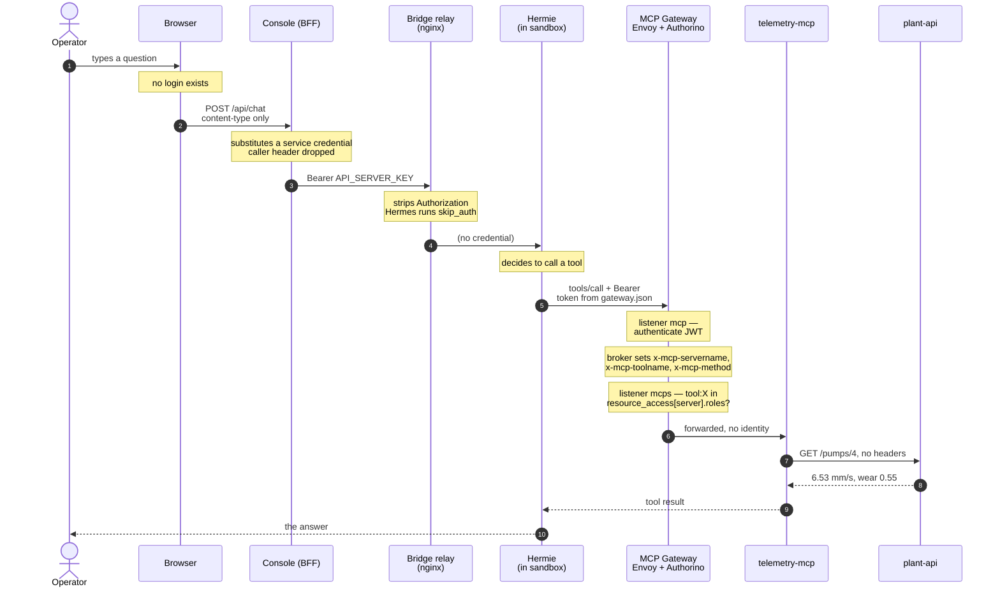
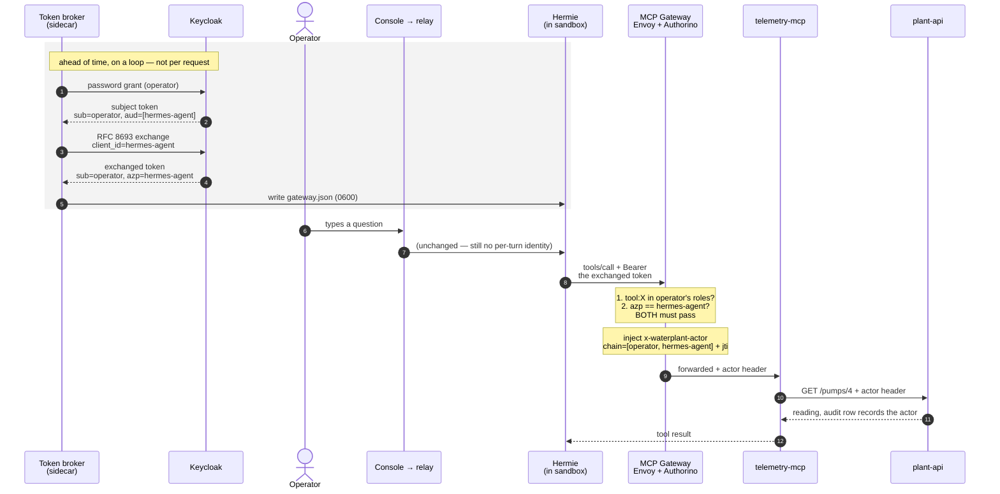
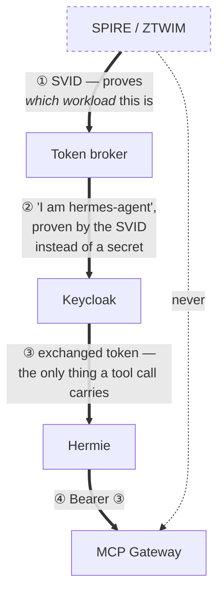
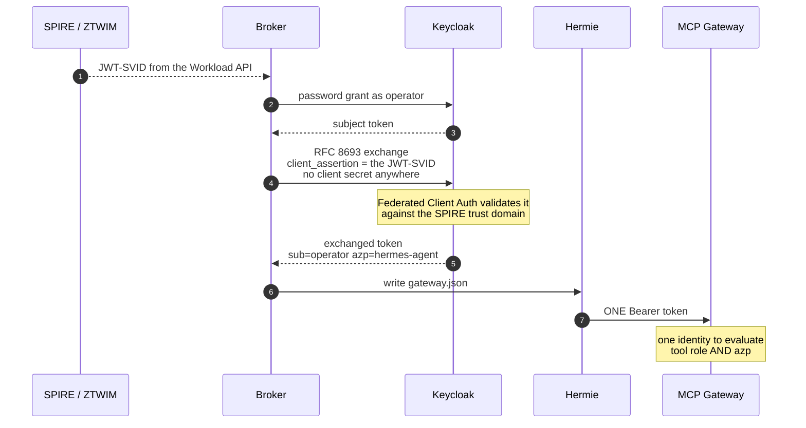
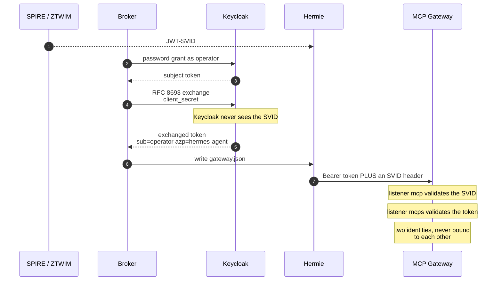

# 10 — One tool call, end to end

> **SUPERSEDED by [12-tool-call-walkthrough-v2.md](12-tool-call-walkthrough-v2.md).** This page
> describes the walk as *designed*; v2 describes it as *built and measured*, and the two differ in
> several places — notably `azp` (now the sandbox's SPIFFE ID), the number of exchanges (two), and
> the roles in the final token (one, not eighteen). Kept for the design reasoning.


The operator types *"What's the status of pump 4?"*. This is every hop it takes, with the exact
credential on each — today, and after the change. Everything here was read off a live sandboxed
tenant (`<user>`), not inferred.

## Today



The token at step 7, decoded live from `/sandbox/.hermes/mcp-tokens/gateway.json`:

```jsonc
{ "azp": "mcp-gateway",          // the public client every caller shares
  "resource_access": { /* 18 tool roles */ },
  "sub":  ABSENT, "aud": ABSENT, "preferred_username": ABSENT }
```

**Four places a principal could live, and none does.** The browser sends none. The console
substitutes a service key. The relay strips what it is given. The one real credential names a
client, not a person. By step 11 the plant is changing state for a request nobody is attached to.

## After

Changes are confined to two places: how the token is minted (step 0, new), and what the gateway
checks and emits (steps 8–9).



The same token at that step, verified on `<user>`:

```jsonc
{ "sub": "<operator-uuid>…",                 // the operator's user id
  "preferred_username": "operator",
  "azp": "hermes-agent",               // the software acting for them
  "aud": "http://mcp-gateway-…:8080/mcp",
  "jti": "…",
  "resource_access": { /* the same 18 roles, unchanged */ } }
```

**Note what did not change.** Hermie is untouched — same image, same config, and it never learns
there was an exchange. The console is untouched. The per-turn path has no new hop. All of it
happens in the sidecar that already held the operator's password, and in a policy that already
existed.

## Where SPIRE fits — and where it does not

A natural reading of "SPIFFE for agent identity" is that SPIRE issues the token the agent presents.
**It does not.** The SVID never reaches the MCP Gateway and is never the tool-call credential.



The SVID answers **"is this really the hermes-agent workload?"** — a question asked once, at the
token endpoint, replacing a shared secret with something attested and unforgeable. The exchanged
token answers **"who is acting, for whom, with what permissions?"** — and that is what travels.

Three consequences worth being clear about:

- **SPIRE is optional to the identity story.** Stages 0–4 deliver agent identity and the
  intersection rule with a client secret and no SPIRE at all. SPIRE upgrades *how the agent proves
  it is itself*; it does not change what the gateway sees or enforces.
- **Keycloak can consume a JWT-SVID for arrow ②, on our exact version.** Not via
  `private_key_jwt` — via **Federated Client Authentication**, which arrived in Keycloak 26.4.0 and
  is listed in our 26.4.18 build as `client-auth-federated[:v1]` and `spiffe[:v1]`. It is not
  enabled (`features: null` on the CR). An earlier revision of these notes said this was blocked
  upstream on the strength of issue
  [#41907](https://github.com/keycloak/keycloak/issues/41907) being closed — that was wrong: #41907
  was closed as a *duplicate* of
  [#42634](https://github.com/keycloak/keycloak/issues/42634), which shipped. The related NPE when
  an SVID carries `iss` ([#43394](https://github.com/keycloak/keycloak/issues/43394)) was fixed in
  26.4.1, so 26.4.18 is past it.
- **If Authorino validates it, the picture changes shape**: the SVID becomes a second credential on
  a different hop rather than a way of obtaining the first, and the two facts are never bound into
  one artifact. [02-target-architecture.md](02-target-architecture.md) covers why that trade-off
  matters.

### How this compares to Uber

Worth being exact, because the two shapes look similar and are not.

Uber's flow: the workload fetches its SVID → presents it **to their STS** with the next-hop
audience → the STS checks an **Agent Registry** that this `agent_id` may run on that workload → the
STS mints **one** JWT carrying `act_chain` → that token goes to the MCP Gateway. **The SVID never
reaches their gateway.** The enforcement point sees a single credential with attestation already
folded in upstream.

| | Uber | **Route A** — SVID to Keycloak | **Route B** — SVID to the gateway |
|---|---|---|---|
| Who consumes the SVID | their STS | Keycloak, as the STS | the gateway |
| Credentials at the enforcement point | **one** | **one** | **two** |
| Attestation bound into the actor token | yes | yes | **no** |
| Matches the reference model | — | **yes** | no |

The real architectural fork is just that: **does the SVID go to Keycloak, or to the gateway?**
Route A matches Uber — Keycloak plays the STS role and the gateway still sees a single token.
Route B is a genuine divergence, and a workshop teaching Uber's model should say so rather than
present them as equivalent.

Route A then has two ways to present the SVID, and this is a sub-choice, not a different
architecture:

| | **JWT-SVID** — leading | **X509-SVID / mTLS** — fallback |
|---|---|---|
| Presented as | `client_assertion` in the POST body — layer 7 | a TLS client certificate — handshake |
| Keycloak mechanism | Federated Client Authentication | RFC 8705, "X509 Certificate" authenticator |
| Needs | a preview feature flag on the CR | client-cert termination on the ingress |
| Support state | preview (the IETF spec is a draft) | stock supported |
| What OpenShell emits | **this one** | not this |

OpenShell's dynamic token grants "request a SPIFFE JWT-SVID from the local Workload API and send it
directly to `token_endpoint` as the OAuth2 client assertion" — so JWT-SVID aligns Keycloak and
OpenShell on one credential type, while mTLS aligns neither and needs changes to an ingress we do
not own. Hence the ranking.

### What "the broker" means

It is a **role, not a component that exists yet** — whatever does the password grant, performs the
exchange, and writes `gateway.json`. Today that role is played by `mcp-token-refresh.py`, and
*where* it runs differs by runtime:

| Runtime | Where the refresher runs |
|---|---|
| `hermes-plain` | an `mcp-token-refresh` **sidecar container** in the hermes-plain pod |
| **sandboxed (our path)** | baked into the sandbox image at `/usr/local/share/hermes-lab/mcp-token-refresh.py`, run by `start-hermes` **inside the sandbox** |
| bridge | a throwaway copy at `$WORK/probe`, only so `wait-for-gateway.py` can run |

So on our path the broker is **inside the sandbox today**. The question the two routes raise is
whether it should stay there.

### The two routes, drawn

**Route A — the SVID goes to Keycloak.** Used *once*, to prove the broker is the `hermes-agent`
workload, replacing the client secret. Keycloak mints the token. **Nothing downstream changes** —
the Stage 3 AuthPolicy is already final. Drawn with the leading binding, a JWT-SVID as the client
assertion; with mTLS only step 4 differs.



**Route B — the SVID goes to the gateway.** It travels all the way to Authorino and is checked
there, *alongside* a token Keycloak minted using the ordinary client secret. Two credentials,
never bound to each other.



### Where the change actually lands

| | Route A — SVID to Keycloak | Route B — SVID to the gateway |
|---|---|---|
| Credentials reaching the AuthPolicy | **one** Bearer token | **two** — a token and an SVID |
| AuthPolicy changes vs. Stage 3 | **none** | a second authentication rule on the public listener |
| What the client secret becomes | **deleted** | still required |
| Where the SVID is consumed | Keycloak's token endpoint | the gateway |
| Blocker | a preview feature flag on an RHDP-owned CR | the OpenShell upgrade |

**The practical answer to "where does this come into play": Route A changes nothing at the gateway
at all.** The AuthPolicy written in Stage 3 — tool role AND `azp == hermes-agent` — is already
final. The only difference is at the Keycloak token endpoint, where `client_secret=…` becomes a
`client_assertion` carrying the SVID. Route B is the one that adds a second credential and a second
authentication rule.

### The security difference, stated plainly

Route A's exchanged token **proves an attested workload obtained it**, because only that workload
could have authenticated to get it. Attestation is welded to the token.

Route B proves two separate things that are never tied together: *somebody holding the client
secret* obtained a token, and *an attested workload* is present on this request. Nothing binds
them. Anyone who learns the secret can mint an equally valid token, and the SVID check does not
notice.

### A practical obstacle for Route B, and an opportunity for Route A

For Route B the SVID must be attached to Hermie's **outbound** MCP call — but Hermie is an
unmodified image that knows nothing about SVIDs. The only mechanism that injects a credential into a
sandbox's outbound request is OpenShell's provider machinery, which means **Route B also depends on
the OpenShell upgrade** (Stage 7). That was not obvious when it was ranked as the easy option, and
it removes most of the "easier" argument for it.

Route A has the opposite property, and it is worth designing for: **the broker does not have to live
inside the sandbox.** Today the refresher is baked into the sandbox image, but the bridge supervisor
already holds the operator credential, already writes files the sandbox consumes, and is an ordinary
pod that can mount a SPIFFE CSI volume directly. Moving the exchange into the bridge would mean:

- no OpenShell SPIFFE support needed, so **Stage 7 stops being a dependency**;
- no sandbox image rebuild;
- and the SVID never enters the sandbox at all — so the agent cannot read, leak, or be tricked into
  using its own attestation credential, which is a stronger property than Uber describes.

That is a design question for Stage 2, not a decision to take here, but it changes the cost balance
between the two routes considerably.

### What OpenShell itself promotes — and why it is not quite either of these

OpenShell has a documented answer, and it differs from both routes above. From the v0.0.116
dynamic-token-grant docs:

> "The **supervisor** requests a SPIFFE JWT-SVID from the local Workload API and sends it directly
> to `token_endpoint` as the OAuth2 client assertion." *(grant_type: client_credentials)*
>
> "The supervisor first asks the gateway for an intermediate token. The request includes the
> supervisor JWT-SVID; the gateway verifies it…" *(grant_type: token_exchange)*
>
> "Token grants require the **sandbox supervisor** to have access to a SPIFFE Workload API socket."

So OpenShell's model is: **the sandbox supervisor holds the SVID; the agent process never does.**
The supervisor mints the token and injects it into the agent's outbound requests at the egress
proxy, leaving an opaque placeholder in the agent's environment.

That is the same pattern the lab already teaches in module 2 with `--provider maas`: the real model
key lives in the gateway, the sandbox gets a placeholder, and the swap happens on the way out. So
OpenShell's promoted path is an extension of machinery participants have already met — which is a
genuine argument for it beyond vendor alignment.

Three separations, then, in increasing order of distance between the credential and the agent:

| Where the SVID lives | Agent can reach it | Attests | Notes |
|---|---|---|---|
| agent process | yes | the agent | nobody proposes this |
| **sandbox supervisor** | no — placeholder only | the sandbox pod | **OpenShell's promoted model**; needs the upgrade |
| bridge pod | no — different pod entirely | **the bridge, not the agent** | stronger isolation, but see below |

**The catch with the bridge, and it is not small.** The bridge is a *different workload* from the
sandbox. If the SVID attests the bridge, then the identity `hermes-agent` really certifies "the
bridge, acting for the operator" — the component actually making tool calls is unattested. We would
have moved the credential further from the blast radius at the cost of attesting something other
than the actor.

Uber attests the workload that **acts**. OpenShell attests the pod that **contains** the actor. The
bridge idea attests the pod that **mints**. Each is defensible; they are not the same claim, and
whichever we choose the documents should say which one we are making rather than calling all three
"workload attestation".

A reasonable reading: OpenShell's supervisor model is the closest practical match to Uber *and* the
vendor-supported path, which is probably why the upgrade is worth doing rather than routed around.

The root cause is simply that **Uber built their own STS** and could make it accept SPIFFE
credentials. We are using Keycloak, which was not designed to — see
[09-implementation-plan.md](09-implementation-plan.md) Stage 8 for the three documented blockers.

## What still has no principal, after all of this

Honest accounting. The change above fixes the agent→gateway hop and everything downstream of it. It
does not fix:

| Hop | Still |
|---|---|
| Operator → browser | no login anywhere in the lab |
| Browser → console | anonymous; `persona: "operator"` is a client-supplied string |
| Console → Hermie | a static service key, and the relay strips even that |

So `sub=operator` in the exchanged token is asserted by the **broker**, which authenticates as the
operator on a loop — not by the person who typed the question. For a lab with exactly one human
persona per tenant that is a fair representation. It would not be in a system with real users, and
the documents should keep saying so.
