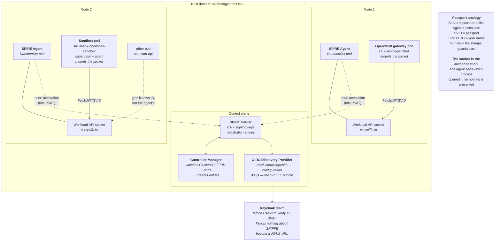
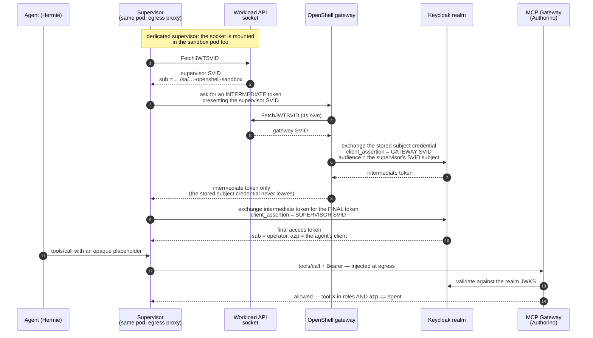

# 11 — OpenShell × SPIFFE/SPIRE, and the corrected end-to-end flow

Two diagrams. The first mirrors the "SPIRE big picture" view but places OpenShell's components in
it. The second is the token flow, corrected against the NVIDIA OpenShell documentation — see
[the accuracy notes](#where-the-circulating-end-to-end-diagram-is-wrong) for what it fixes.

Verified against: [Provider Profiles](https://docs.nvidia.com/openshell/latest/how-it-works/providers/profiles.md),
[Access Control](https://docs.nvidia.com/openshell/kubernetes/access-control),
[the Kubernetes driver README](https://github.com/NVIDIA/OpenShell/blob/main/crates/openshell-driver-kubernetes/README.md),
and [issue #1987](https://github.com/NVIDIA/OpenShell/issues/1987) (closed, shipped in #1970).

## 1. Where OpenShell sits in a SPIRE deployment



**One config key, two mounts.** `drivers.kubernetes.provider_spiffe_workload_api_socket_path`
names the path, and with a **dedicated** supervisor the driver CSI-mounts the socket into *both*
the gateway pod and each sandbox pod:

> "Dedicated supervisors use `gatewayConfig.openshell.drivers.kubernetes.provider_spiffe_workload_api_socket_path`
> to mount the CSI Workload API socket into gateway **and sandbox** pods. Shared supervisors instead
> use the gateway's SPIFFE Broker API integration; only the gateway mounts the socket."

Each pod gets *its own* identity from that socket — the gateway gets
`…/sa/user-x-openshell`, the sandbox `…/sa/user-x-openshell-sandbox`. Both are needed, because
each signs a different hop below.

## 2. The token flow, as the docs describe it



Two exchanges, not one, and **two different SVIDs sign them**. Hence two Keycloak federated
clients: one bound to the gateway's SPIFFE ID for the intermediate exchange, one bound to the
sandbox's for the final one. Because `azp` on the *final* token names the client that
authenticated the *last* exchange, the **sandbox's** client is the one that must be called
`hermes-agent` — that is the value `mcp-authz-policy` asserts.

The subject credential is deliberately *broker-only*: the profile "cannot declare workload
injection metadata such as env vars, static placement, refresh, or token grant metadata", so it
exists only for the gateway to exchange and is never injected anywhere.

## Four things this corrects in how we described the flow

Every row below is a claim made earlier in this document set or in the working notes, and every one
is wrong. They are kept here rather than silently edited away, because three of them are the sort
of error that reads as correct right up to the moment a grant fails.

| What we said | Reality |
|---|---|
| The gateway does *the* exchange, Keycloak returns the final token | **Two** exchanges. The gateway's produces an *intermediate* token; the supervisor then exchanges that for the final one with its own SVID |
| "the sandbox then holds no Keycloak credential at all" | False as written. The supervisor fetches an SVID and receives tokens, and the supervisor runs *in the sandbox pod* as PID 1. The true statement is that **the agent** never holds them: Hermie carries a placeholder, swapped at egress. That distinction is the whole point, and the loose phrasing erases it |
| `azp` names the SPIFFE ID of the workload that authenticated | `azp` is a Keycloak **client id**. A SPIFFE ID maps to a client *through* `jwt.credential.sub`; it never appears in the token. The whole design turns on `azp == 'hermes-agent'`, so this is not pedantry |
| One federated client, `hermes-agent`, bound to the gateway's SPIFFE ID | **Two** clients, one per signing identity — and `hermes-agent` must be bound to the **sandbox's**, since `azp` on the final token names the client that signed the *last* exchange. Artifact C24 currently stages the gateway's |

Everything else holds up: the egress injection, Authorino validating the realm-issued JWT against
Keycloak's JWKS, the `azp` predicate, and SPIRE's OIDC provider as the verification anchor.

## Why two SVIDs — and why two clients is the property, not the overhead

Verbatim, `profiles.md` line 836:

> | `token_exchange` | The supervisor first asks the gateway for an intermediate token. The request
> includes the supervisor JWT-SVID; the gateway verifies it, uses the SVID subject as the
> intermediate token audience, and exchanges the stored subject credential at the same
> `token_endpoint` using **the gateway's own JWT-SVID as the client assertion**. The supervisor
> then exchanges that intermediate token for the final upstream token using **its own JWT-SVID as
> the client assertion**. |

Two client assertions, two signers, **one `token_endpoint`**. Keycloak resolves a federated client
by matching `jwt.credential.sub` against the assertion's subject and requires exactly one match, so
two signers means two clients. That is arithmetic, not a preference.

It is also not ceremony, and this is the answer to "why does it need both": the two identities hold
deliberately different authority.

- The **gateway** can mint an intermediate token for *any* sandbox, because it is the party holding
  the user's subject token.
- A **sandbox** can only redeem an intermediate token *addressed to its own SPIFFE ID* — "the
  gateway intermediate exchange always uses the verified supervisor SVID subject as its audience"
  (line 867).

Collapse them into one identity and the sandbox inherits the gateway's power: it could mint tokens
naming other sandboxes, and it would effectively hold the user's delegation rather than a token
scoped to itself. The second client is precisely what stops the sandbox from being able to mint.

This holds in **both** supervisor modes. Shared supervisors move only the *socket*, not the identity
count: "Only the gateway mounts the Workload API socket, including for its own JWT-SVID in
`token_exchange`" (line 877). The gateway then presents the stable sandbox SVID for the final
exchange and its own for the intermediate one — still two subjects at the token endpoint.

## The blocker nobody has mentioned: the subject token does not refresh

Verbatim, `profiles.md` line 847:

> For `token_exchange` profiles, the provider also stores the user subject token referenced by
> `token_grant.subject_token.credential`. That credential is gateway-only… Create or update that
> provider credential from the current gateway OIDC login with `--from-oidc-token`. **This requires
> an active named gateway that was registered for OIDC.** … **OpenShell does not store the OIDC
> refresh token in the provider. When the stored subject-token credential expires, the gateway
> rejects intermediate token exchange until the provider is updated with a fresh token.**

Three consequences:

1. **It expires.** Our realm sets `accessTokenLifespan: 1800`, so the stored operator token dies
   every 30 minutes and intermediate exchange fails until something replaces it.
2. **It cannot refresh itself.** Being broker-only it "cannot declare workload injection metadata
   such as env vars, static placement, refresh, or token grant metadata", so the
   `oauth2_refresh_token` strategy is *not* available to it. An earlier note in
   [PROGRESS.md](PROGRESS.md) suggested a refresh token would keep it fresh; that was wrong.
3. **`--from-oidc-token` wants a gateway registered for OIDC.** Ours runs mTLS
   (`openshell gateway list` → `AUTH: mtls`) with `allow_unauthenticated_users = true` and no OIDC
   registration.

### Settled on the cluster, 2026-11-25

Consequence 3 **is not a blocker**, and the re-stamp is a one-liner. Tested end to end on the live
gateway, then cleaned up:

```
openshell provider profile lint   --file wp2.yaml   → Provider profile lint passed.
openshell provider profile import --file wp2.yaml   → Imported 1 provider profile.
openshell provider create --name wptest --type waterplant-mcp   --credential operator_token=<operator access token>   → Created provider wptest
openshell provider get wptest   → Credential keys: operator_token
openshell provider update wptest --credential operator_token=<fresh>  → Resource version: 2
```

So a plain `--credential` sets the broker-only subject credential and `provider update` re-stamps
it — no gateway OIDC registration needed. Note `--credential` and `--runtime-credentials` are
**mutually exclusive** ("the argument '--credential' cannot be used with
'--runtime-credentials'"), so the earlier plan step saying to create the provider with
`--runtime-credentials` was wrong: for a `token_exchange` profile the subject credential *is*
stored, and only `gateway_token` is minted at runtime — which is exactly what
`Credential keys: operator_token` shows.

What remains a real cost is consequence 1: the stored token dies with
`accessTokenLifespan: 1800`, so something must run that `provider update` on a timer. The natural
home is the bridge supervisor, which already runs a role-watch loop and already holds the operator
password — keeping the password out of the sandbox, the property that actually matters.

The profile and provider used for this test were both deleted (`provider delete wptest`,
`provider profile delete waterplant-mcp`); the tenant is back to its single `maas` provider.

Also checked and unavailable: [PR #5479](https://github.com/NVIDIA/OpenShell/pull/5479), a
gateway-signed alternative to SPIFFE assertions, is a **draft and unmerged**, and applies only to
`client_credentials` — so it would not preserve user delegation even if it shipped.

## The alternatives, side by side

| | Who signs at Keycloak | Clients | Preserves `sub`=operator | Sandbox holds | Image build | Main cost |
|---|---|---|---|---|---|---|
| **A. OpenShell `token_exchange`** | gateway + supervisor | 2 | **yes** | only its own final token | likely none — injected at egress | subject token expires every 30 min and needs a re-stamp loop (`provider update`, proven). Gateway OIDC is **not** a prerequisite — `--credential` works |
| **B. OpenShell `client_credentials`** | supervisor only | 1 | **no** — token represents the sandbox client, not the user | its own token | likely none | loses delegation entirely, so the `sub`+`azp` story collapses. Rejected on those grounds |
| **C. Our broker, in the sandbox** | supervisor-equivalent | 1 | yes | the operator password | **yes** — needs a SPIFFE-capable client in the image | puts the human's password in the untrusted box, which is the thing the design exists to prevent |
| **D. Our broker, on `hermes-plain`** | the `hermes-plain` pod | 1 | yes | n/a — not the sandbox runtime | none (sidecar + CSI volume) | proves the mechanism cheaply, but on the runtime the console is not pointed at, and the operator password still sits beside the agent |
| **E. Keep the shared secret** | nobody | 1 | yes | the secret | none | the status quo, and the objection Stage 8 exists to answer |

## Why there are two identities, in plain language

> **The decision this frames.** It is not about complexity. Our current design — and option D
> below — works, and is one security property weaker: the operator's credential sits in the same
> pod as the agent, exactly as the password grant does today. Swapping that secret for an SVID is
> a real improvement and needs one identity and one client. The second identity buys precisely one
> thing: the human's credential moves out of the agent's reach. The question is whether that is
> worth the machinery for a teaching lab — not which option is tidier.

The short version: **an SVID says nothing about a human, so it cannot by itself buy a token that
names one.** Everything else follows from that.

### What an SVID actually contains

> "I am the sandbox workload in namespace `user-x-agentops`."

That is the entire content. No operator, no user, no delegation. So if the sandbox walks up to
Keycloak holding only its SVID, the best Keycloak can honestly return is a token about *the
machine*. That is exactly what the `client_credentials` grant does, and exactly why NVIDIA's
[issue #1987](https://github.com/NVIDIA/OpenShell/issues/1987) rejects it for this purpose: "the
resulting token represents the sandbox/supervisor client rather than the user."

To mint a token that says *operator is the subject, agent is the actor*, Keycloak needs **two**
inputs:

1. proof of **which software** is asking — the SVID;
2. proof that **the human authorised it** — a credential belonging to the operator.

Which raises the only question that matters: **who is allowed to hold the operator's credential?**

### Why not the sandbox

If the sandbox holds it, a prompt-injected agent can read it and mint whatever the operator can do,
for as long as it lasts, with no agent identity attached. That is the failure the whole design
exists to prevent. So it must live outside the sandbox — and in OpenShell's model, that is the
gateway.

### The analogy

An employee wants a contractor to do a job. The building's security desk will only open a door if
the pass names both of them.

| In the building | Here |
|---|---|
| The contractor's **company badge** — proves "I am contractor #7", names no employee | the sandbox's **SVID** |
| The employee's **letter of authorisation** | the **subject token** (the operator's credential) |
| **HR**, who issues the day pass naming *both* parties | **Keycloak** |
| The **day pass**: "Employee Jane, work by contractor #7, room 3, expires 5pm" | the exchanged token: `sub`=operator, `azp`=hermes-agent |
| The **front office**, which keeps the letter in a drawer | the **OpenShell gateway** |

Hand the letter to the contractor and they can photocopy it and use it forever. So the front office
keeps it. The contractor shows their badge; the front office takes the letter to HR and returns
with a **voucher made out specifically to contractor #7**, useless to anyone else. The contractor
then swaps that voucher at HR for the real day pass.

That is the two hops. The first exists *only* because the letter must stay in the drawer.

### So why does the front office need a badge of its own?

Because when it walks up to HR holding an employee's letter, HR must decide whether to act on it.
If HR honours that letter from *anyone* who presents it, the letter is just the password we were
trying to abolish — whoever steals it gets a day pass. So the front office identifies itself too:
*"I am the front office, asking on behalf of Jane, for contractor #7."*

The gateway's SVID is that badge. It is **not** a second agent identity; it is the identity of *the
component trusted to hold human credentials*. Two different jobs, two different badges:

- the gateway's badge means **"I may ask on a human's behalf"**;
- the sandbox's badge means **"I am the contractor this voucher was made out to."**

And the voucher is bound to the sandbox's badge — the gateway "uses the SVID subject as the
intermediate token audience" — which is what stops one sandbox redeeming another's voucher. Merge
the two badges and the sandbox inherits the right to ask on any human's behalf, which is precisely
what we were avoiding.

### The honest caveat

A one-identity design is perfectly coherent — it is just **one security property weaker**. It works
if you accept that the agent's own pod holds the operator's credential. That is what the lab does
today: the refresher performs a password grant as `operator` right beside the agent. Swapping that
secret for an SVID is a real improvement and needs only one identity and one client.

The second identity buys exactly one thing: the human's credential moves out of the agent's reach.
That is the difference between *"the agent is trusted with the human's authority"* and *"the agent
can only redeem a voucher issued for it specifically."* If that is not worth it for a teaching lab,
the one-identity design is the right call and the second hop disappears.

### An editable version of this picture

[`diagrams/openshell-two-badges.excalidraw`](diagrams/openshell-two-badges.excalidraw) draws the
same story as a flow with the eight numbered steps, both badges, and the legend above.

**To open or edit it:** go to <https://excalidraw.com> and drag the file onto the canvas (or
*Menu → Open*). Nothing to install, no account. Export with *Menu → Export image* — tick
**"Embed scene"** so the exported `.png`/`.svg` can be dragged back in and re-edited later. If you
would rather it lived in the lab guide, export to SVG and drop it in `content/`; the `.excalidraw`
file stays here as the editable master.

## Per-tool tokens and a true intersection — both proven on the cluster

Two properties were tested directly against realm `waterplant-<user>` on 2026-11-26, then reverted.
Both are stock Keycloak and need **no** change to the AuthPolicy.

### A true intersection: give the agent its own roles

Today the exchanged token carries the operator's roles verbatim and the policy adds
`azp == 'hermes-agent'` — so it is "the human's permissions, *and* the caller is the agent", not an
intersection of two role sets.

Keycloak computes a real intersection natively when a client has **`fullScopeAllowed: false`**: the
roles in an issued token become *the user's roles ∩ the client's scope mappings*.

| Setup | Exchanged token |
|---|---|
| `fullScopeAllowed: true` (today) | 18 roles — telemetry 6, maintenance 5, control 7 |
| `fullScopeAllowed: false`, no scope mappings | **0 roles** |
| `fullScopeAllowed: false` + 3 telemetry roles mapped to the agent | **exactly those 3**, while the operator still holds all 18 |
| the same, but `tool:get_pump_status` **revoked from the operator** while still mapped to the agent | **2 roles** — the revoked one is absent |

That last row is the one that makes it an intersection rather than a substitution, and it was added
on re-verification because the first pass only tested one direction. Both directions now hold:

```
operator 18 ∩ agent 3   → 3    the agent narrows the human
operator 17 ∩ agent 3   → 2    the human narrows the agent
```

Neither side can grant what the other lacks. That is the property the design has been claiming and,
until now, only half-demonstrating.

`azp` and `preferred_username` are unaffected. The existing predicate
`('tool:' + toolname) in resource_access[...]` then enforces the intersection for free.

This is a better exercise than the one we have: revoke a tool from the **agent** and the operator
keeps it in the UI while Hermie can no longer use it — the distinction between *what the human may
do* and *what the human may delegate*, made visible.

### Per-tool tokens: one role per token, Uber-style

Put each tool's role in its own **optional client scope** and request it at exchange time.

| Request | `scope` claim | `resource_access` |
|---|---|---|
| no `scope` parameter | `roles groups` | **none** |
| `scope=tool-get_reservoir_level` | `roles groups tool-get_reservoir_level` | exactly `tool:get_reservoir_level` |

And the safety property that makes it trustworthy — tested by revoking the role from the operator
and asking for the scope anyway:

| Request | Result |
|---|---|
| `scope=tool-get_reservoir_level`, operator **lacks** that role | **no roles at all**, and the scope is dropped from the `scope` claim |

A requested scope can only ever *narrow*, never grant. The blast radius of a stolen token drops
from "every tool the operator has" to "the one tool in flight".

### What it costs

- **One client scope per tool** — 18 here. Mechanical: `mcp-gateway.yaml` already loops over
  `keycloak.toolRoles`, so the chart generates them.
- **An exchange per distinct tool**, so a Keycloak round trip on first use of each tool. Cache per
  tool for the token's lifetime; OpenShell's `token_grant` has `cache_ttl_seconds` for exactly this.
- **Shorten the lifetime.** `accessTokenLifespan` is 1800s today; per-tool tokens only pay off if
  they are short.
- One wrinkle: OpenShell's `audience_overrides` selects by host, port and path — and MCP is
  JSON-RPC to a single `/mcp` path with the tool named in the *body*, so that mechanism gives
  per-**server** granularity, not per-tool. Per-tool scoping has to be driven by whatever requests
  the exchange.

## Confidence

Section 1's mount behaviour is **proven on this cluster**: a sandbox created by the 0.0.116 gateway
carries a `csi.spiffe.io` volume at `/spiffe-workload-api` and resolves
`spiffe://agentops.lab/ns/<user>-agentops/sa/<user>-openshell-sandbox`. See PROGRESS.md,
2026-11-25.

Section 2 is **read from documentation published as v0.1.6 against a build reporting 0.0.116**, and
is not yet cluster-proven. It lines up where it can be checked — the `token_grant` schema matched
the shipped binary field for field, and `provider profile lint` enforces the same
`subject_token.source must be provider_credential` rule the docs describe — but the three-hop
sequence, and therefore the two-client conclusion, stands on the reading alone. Do not treat the
second client as settled until a real grant runs.
