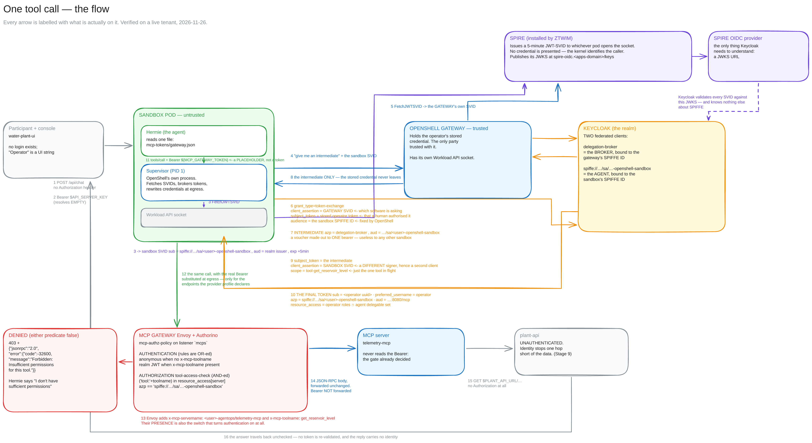
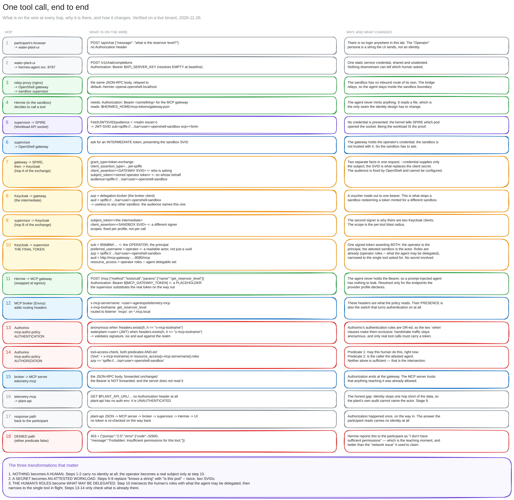

# 12 — One tool call, end to end (v2)

Supersedes [10-tool-call-walkthrough.md](10-tool-call-walkthrough.md), which described the design
before it was built. This one describes **what actually happens**, hop by hop, on a tenant where it
has been verified.

A participant types *"what is the reservoir level?"* into the console. Eighteen things happen. This
document is every one of them: what is on the wire, why it is there, and how it changes.

### The flow

Every arrow carries what is actually on it, and why.

> **Amended 2026-11-26.** Two details below were written from the design rather than the build.
> Step 10's token carries the agent's **delegable set** intersected with the operator's roles, not a
> single tool role — per-call scope selection is not reachable through OpenShell's grant. And in
> step 11 the supervisor's proxy decorates the request **whatever the agent sends**, so the
> placeholder is belt-and-braces rather than load-bearing.



### The same 18 hops as a reference table

Use this one when you want to look a single hop up rather than trace the path.



Editable masters: [`diagrams/tool-call-flow.excalidraw`](diagrams/tool-call-flow.excalidraw) and
[`diagrams/tool-call-v2.excalidraw`](diagrams/tool-call-v2.excalidraw) — each `.png` has the scene
embedded, so either file opens in <https://excalidraw.com>. Generated by
[`gen-tool-call-flow.py`](diagrams/gen-tool-call-flow.py) and
[`gen-tool-call-v2.py`](diagrams/gen-tool-call-v2.py); re-render with

```bash
npx -y mcp-excalidraw-server@2.2.0 render docs/agent-identity/diagrams/tool-call-v2.excalidraw \
  --out docs/agent-identity/diagrams/tool-call-v2.png --format png --scale 2 --embed-scene
```

## The shape of it, before the detail

Three questions have to be answered before a tool runs, and they are answered in three different
places:

| Question | Answered by | Using |
|---|---|---|
| *Which software is asking?* | **SPIRE**, via a socket | what the pod **is** — namespace and service account |
| *Did a human authorise this?* | **Keycloak**, via token exchange | a credential the operator authorised, held by the gateway |
| *Is this specific call allowed?* | **Authorino**, at the MCP gateway | the one signed token carrying both of the above |

The design's whole trick is that the third question needs only **one** bearer token, because the
first two were already fused into it. That is why there is no second credential at the gateway and
no change to the enforcement point.

## The cast

| | |
|---|---|
| **Operator** | A persona, not an account the participant logs into. A Keycloak user named `operator` whose tool roles the participant grants and revokes — that *is* the module-3 exercise. |
| **Hermie** | The agent. Runs inside the sandbox. Reads a token from a file and never mints anything. |
| **Supervisor** | PID 1 inside the sandbox pod. OpenShell's own process: fetches SVIDs, brokers tokens, and rewrites outbound credentials at egress. Not ours. |
| **OpenShell gateway** | A separate pod. Holds the operator's stored credential. The only party trusted with it. |
| **SPIRE** | Issues short-lived SVIDs (5 minutes) based on pod identity. Installed by ZTWIM. |
| **Keycloak** | The authorization server. Two federated clients: a **broker** and an **agent**. |
| **MCP gateway** | Envoy + Authorino. Routes tool calls and enforces the policy. |
| **MCP servers** | `telemetry-mcp`, `maintenance-mcp`, `control-mcp`. Expose the tools. |
| **plant-api** | The simulated plant. **Unauthenticated.** |

## Steps 1–4 — no identity at all yet

The participant's browser posts to the console with **no `Authorization` header**. There is no
login anywhere in this lab, and "Operator" is a string the UI sends, not a credential. The console
then calls the agent with a single static service key — which, at baseline, resolves to empty.

So for the first four hops **nothing on the wire names anybody**. This matters: it is why the
identity work starts inside the sandbox rather than at the front door. Fixing the front door would
be a different project (real participant login), and it would not make the agent's own actions
attributable.

Hermie decides a tool is needed, and reaches for a bearer token the only way it knows: it reads
`$HERMES_HOME/mcp-tokens/gateway.json`. **That file is the single seam the whole design turns on.**
Everything below is about what gets written there.

## Step 5 — the socket is the authentication

The supervisor asks SPIRE for a JWT-SVID over a Unix socket mounted at `/spiffe-workload-api`.

It presents no credential, because it does not need one. When a process opens that socket the
kernel tells the SPIRE agent which process connected; SPIRE traces it to a container, a pod, and
that pod's service account, and issues an SVID for *that* identity. **Being the workload is the
proof.** Copy the socket path into another pod and it gets that pod's identity, not yours.

The SVID says exactly one thing:

```
sub = spiffe://agentops.lab/ns/<user>-agentops/sa/<user>-openshell-sandbox
aud = <the Keycloak realm issuer>
exp = +5 minutes
```

Note what it does **not** say: anything about a human. This is the fact the rest of the design is
shaped around — a badge proves which software is calling and nothing more.

## Steps 6–10 — two exchanges, two signers

Because an SVID names no human, Keycloak cannot mint a token naming the operator from an SVID
alone. It needs two inputs: proof of **which software** is asking (the SVID) and proof that **the
human authorised it** (a credential belonging to the operator).

Which raises the only question that shapes the architecture: *who is allowed to hold the operator's
credential?* Not the sandbox — a prompt-injected agent that could read it could mint anything the
operator may do. So the **gateway** holds it, and the sandbox has to ask.

**Step 7, the intermediate exchange.** The gateway fetches its *own* SVID and calls Keycloak with
both facts at once:

```
client_assertion = <GATEWAY SVID>            who is asking
subject_token    = <stored operator token>   on whose behalf
audience         = spiffe://…/sa/<user>-openshell-sandbox
```

The `client_assertion` is what replaces a client secret. This is worth being precise about, because
it is the question people ask: `--credential` stores the *subject* token, nothing more. Without the
gateway's SVID the gateway would still have to prove it is the broker client — with a secret, which
is the exact thing being removed. **Two slots, two credentials.**

**Step 8, the voucher.** Keycloak returns an intermediate token with `azp = delegation-broker` (the
broker) and `aud` set to the sandbox's SPIFFE ID. That audience is fixed by OpenShell and cannot be
configured — and it is what stops one sandbox redeeming a token minted for another.

**Step 9, the final exchange.** The supervisor exchanges that intermediate for the real token using
its *own* SVID, plus `scope=tool-<name>` for the one tool in flight. A different signer, hence a
second Keycloak client.

**Step 10, the token that does the work:**

```
sub                = <operator uuid>       the human principal
preferred_username = operator              a readable actor, not just a uuid
azp                = spiffe://…/sa/<user>-openshell-sandbox
aud                = http://mcp-gateway-…:8080/mcp
resource_access    = { telemetry-mcp: [ tool:get_reservoir_level ] }
```

One signed token asserting **both**: the operator is the principal, the attested sandbox is the
actor. And `resource_access` already holds the intersection of what the human may do with what the
agent may be delegated — narrowed to the single tool asked for. No secret was involved at any point.

### Why `azp` is a SPIFFE ID and not a friendly name

Because `azp` names whichever client signed the *last* exchange, and that client's id must appear in
the intermediate token's audience — which OpenShell fixes to the supervisor's SVID subject. So the
agent client is **named by its SPIFFE ID**, and the policy predicate is templated from the same
value rather than written as a literal. This is forced by the design, not chosen.

## Step 11 — the agent never holds the bearer

Hermie sends `Authorization: Bearer ${MCP_GATEWAY_TOKEN}` — **the literal placeholder**, not a
token. The supervisor substitutes the real bearer on the way out, and only for the endpoints the
provider profile declares.

That is the property the whole arrangement exists for: a prompt-injected agent has nothing to leak.
It is also the precise reason the sandbox image needed a change — the refresher used to write a real
JWT into that file and now writes the placeholder instead.

## Steps 12–14 — where the decision is made

The broker adds two headers:

```
x-mcp-servername: <user>-agentops/telemetry-mcp
x-mcp-toolname:   get_reservoir_level
```

These are what the policy reads — and their **presence is also the switch** that turns
authentication on. Authorino's authentication rules are OR-ed, never AND-ed, so `mcp-authz-policy`
uses two mutually exclusive `when` clauses:

```
anonymous            when !headers.exists(h, h == "x-mcp-toolname")
waterplant-<user>    when  headers.exists(h, h == "x-mcp-toolname")   -> validate the JWT
```

Handshake traffic (`initialize`, `tools/list`) stays anonymous; only a real tool call must carry a
token. Then `tool-access-check` applies two predicates, **AND-ed** because predicates within one
`patternMatching` block always are:

```
('tool:' + x-mcp-toolname) in resource_access[x-mcp-servername].roles
azp == 'spiffe://…/sa/<user>-openshell-sandbox'
```

Predicate 1 asks *may this human do this, right now* — it reads live role state, which is what makes
revocation in the Keycloak console take effect on the next call. Predicate 2 asks *is the caller the
attested agent*. Neither alone is sufficient.

**Where the intersection actually lives, since this is the most common misreading.** The policy does
**not** compare the operator's roles against the agent's. It cannot: the token carries one role set,
not two. Keycloak already intersected them at step 10, so a role present in the token means both
sides allowed it. Same guarantee, enforced one hop earlier — which is why no AuthPolicy change was
needed for it.

There are two AuthPolicies, on two listeners of the same Gateway, both on port 8080:

| Policy | Listener | Role |
|---|---|---|
| `mcp-auth-policy` | `mcp` | the broker's own endpoint |
| `mcp-authz-policy` | `mcps` (`*.mcp.local`) | where tool calls land, and where the two predicates run |

### "Why not just write `agent.permissions & operator.permissions` in the policy?"

The reasonable version of this question is: Authorino predicates clearly support boolean logic, and
CEL can intersect lists, so why push the work into Keycloak?

**Boolean AND is used — that part is right.** `&&` joins the two predicates, and separate
`authorization` rules are AND-ed too. Nothing about the policy language is the obstacle.

**What is missing is the second permission set.** The token Authorino sees carries exactly one
`resource_access`. There is no `agent.permissions` claim and no `operator.permissions` claim to
intersect — there is one role list, and it is already the answer.

Two things make that so:

- **The agent's delegable set is not a claim anywhere.** It is *configuration*: which `tool-*`
  client scopes are attached to the agent client, plus `fullScopeAllowed: false`. It never travels
  on the wire.
- **The intermediate token never reaches the gateway.** It is consumed by Keycloak at step 9 and
  goes no further. Only the final token is presented, so there are not "two tokens at the gate" —
  there is one.

The nearest thing to a second set is the `scope` claim, which lists the `tool-*` scope that was
requested. But that is *what was asked for*, not *what the agent may be delegated*, and comparing
the two would check nothing: a scope the agent does not hold is silently dropped before the token
is issued.

**Could both sets be made present?** Yes — a hardcoded claim mapper could stamp the agent's
delegable tools into the token, and then a CEL predicate could intersect them (CEL has no set `&`;
it would read `a.filter(x, x in b)`). It is strictly worse on four counts: the list is duplicated in
two places and can drift; revoking a tool from the agent becomes editing a mapper rather than
detaching a scope; the claim is non-standard, so nothing else understands it; and the value is
*asserted* by a mapper rather than *computed* from the real grants.

**The deciding argument is stronger than any of those.** Intersecting in the policy means the token
is allowed to carry a permission outside the intersection, and the policy is trusted to reject it.
Intersecting at mint time means such a token **cannot be issued at all**. A credential that cannot
express the violation beats a check that refuses it — if the AuthPolicy is ever misconfigured,
deleted, or bypassed on another listener, the mint-time guarantee still holds. That is why
`fullScopeAllowed: false` is described elsewhere in these documents as load-bearing.

What the policy *must* still do is the part Keycloak cannot: confirm the caller is the attested
agent (`azp`), and check the human's permission **at call time** against roles that may have been
revoked since the token was minted. Those are predicates 2 and 1 respectively, and they are exactly
what is there.

## Steps 15–17 — past the gate, identity thins out

The broker forwards the JSON-RPC body to the MCP server unchanged. **The bearer is not forwarded**,
and the server does not read it: authorization ended at the gateway, and the server trusts that
anything reaching it was already allowed.

The MCP server then calls plant-api with **no `Authorization` header at all** — plant-api has no
auth configuration of any kind. This is the honest gap: identity stops one hop short of the data, so
the plant's own records cannot name the actor. Closing it is Stage 9, and it is the reason
`raised_by: "unknown"` still exists on work orders.

On the way back nothing is re-checked. The answer the participant reads carries no identity at all.

## Step 18 — the denial, which is the teaching moment

If either predicate is false, Authorino returns 403 with a JSON-RPC error body:

```json
{"jsonrpc":"2.0","error":{"code":-32600,"message":"Forbidden: Insufficient permissions for this tool."}}
```

Hermie surfaces that to the participant as *"I don't have sufficient permissions"* — which is the
whole point of the exercise, and a genuine improvement on the misleading *"network issue or service
outage"* it used to report for a 403.

## What is not on this path

Worth stating so the diagram is not read as the whole system:

- **`nemo-guardrails`** runs in the namespace, but no deployment references it by environment, so it
  is not on the tool-call authorization path as currently wired.
- **MLflow tracing** rides alongside: spans leave the sandbox through the bridge's relay, which needs
  the `mlflow_tracing` egress rule. Traces carry the tenant's ServiceAccount identity, not the
  operator's — joining a trace to a gateway decision is Stage 9's `jti` work.
- **`hermes-plain`** is a second runtime of the same agent, reached directly rather than through
  OpenShell. It performs the exchange with the broker client's secret, so it gets `sub` and
  `azp = delegation-broker` but neither attestation nor per-tool narrowing.

## The three transformations

1. **Nothing becomes a human.** Steps 1–2 carry no identity. The operator becomes a real subject only
   at step 10, and only because the gateway held a credential the human authorised.
2. **A secret becomes an attested workload.** Steps 5–9 replace "knows a string" with "is this pod" —
   twice, with two different SVIDs, which is why there are two Keycloak clients.
3. **Eighteen permissions become one.** Step 10 intersects the human's roles with what the agent may
   be delegated, then narrows to the single tool. Steps 13–14 only check what is already there.

## Verifying each claim yourself

| Claim | How to check |
|---|---|
| The SVID names the pod, not a secret | `spire-agent api fetch jwt -audience <issuer>` from a pod with the SA |
| Two exchanges, two signers | Replay steps 7 and 9; `apply-realm-identity.sh` prints the commands |
| The final token carries both facts | Decode it: `sub`, `preferred_username`, `azp`, `resource_access` |
| Roles are the intersection | Revoke a tool from `operator`, re-run step 9 — the role disappears |
| A scope cannot exceed the human | Ask for a `tool-*` scope the operator lacks: 0 roles, scope dropped |
| Both predicates are required | Present a raw operator token (fails predicate 2) or revoke the role (predicate 1) |
| plant-api is unauthenticated | `oc get deploy plant-api -o jsonpath='{...env[*].name}'` — no auth vars |

See [PROGRESS.md](PROGRESS.md) for the measured results of every one of these.
