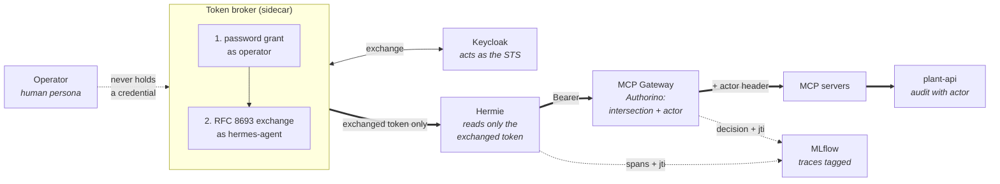

# Agent identity for the AgentOps workshop

Design documents for giving Hermie — the waterplant assistant participants operate in the
*AgentOps in Action* lab — an identity of its own, distinct from the human operator it acts for.

**Status: design only.** Nothing here is implemented. No chart, no image, and no lab content has
been changed. [07-phasing.md](07-phasing.md) proposes how it would be built; everything else
describes the target.

## Why

[Uber's "Solving the agent identity crisis"](https://www.uber.com/us/en/blog/solving-the-agent-identity-crisis/)
names two problems. This lab has both, and in a sharper form than Uber describes.

**The identity model gap.** Hermie *is* the Operator. The token refresher does an OAuth2 password
grant as realm user `operator` through the shared public client, and every tool call presents that
one bearer. So the MCP Gateway can only ever ask *"does the operator hold `tool:X`?"* — never
*"is this agent allowed to act for this human?"*. There is no agent to ask about.

**Lost provenance.** Verified on a live tenant: the token Hermie presents carries
**no `sub`, no `aud`, no `preferred_username`**. It is a bearer of 18 permissions with no
principal attached. Downstream, nothing recovers what was never there — MLflow traces are written
under one ServiceAccount per tenant, attack probes are byte-identical to human turns, and the only
"who" anywhere in the system is `raised_by` on a work order: a free-text field the *model* fills
in, defaulting to `"unknown"`.

The repo already asks for this fix in two places:

> "reusing `operator` would make attack traffic indistinguishable from the participant's own in
> every trace they inspect, which is precisely what modules 4 and 5 are teaching them to tell
> apart"
> — `automation/gitops/bootstrap-infra/files/attack-eval-runner/plant_state.py:14-20`

> "tracing and identity belong at MCP Gateway, where they survive a harness swap"
> — `automation/gitops/tenant-platform/values.yaml:440-443`

## Where identity stands today

| Hop | Credential on the wire | Who the caller appears to be |
|---|---|---|
| Human → browser | — | No login exists anywhere |
| Browser → console | `content-type` only | Anonymous, plus an unverified `persona: "operator"` string |
| Console → agent | static `API_SERVER_KEY` | One service credential |
| Agent → MCP Gateway | `operator` password-grant token | **No subject at all**; `azp` = the shared public client |
| Gateway → MCP servers | not read | Nothing |
| MCP servers → plant-api | no headers | plant-api is unauthenticated |
| Any action → plant state | — | Control actions record no actor; work orders record a model-authored string |
| Anything → MLflow | tenant ServiceAccount token | The pod |

## The target, in one picture

The agent never sees the operator's credential, and the token it does hold says two things at once:
*the operator is the principal, `hermes-agent` is the software acting for them.* The gateway then
enforces the **intersection** of what the human may do and what the agent may do, and stamps the
resulting actor onto everything downstream.

## The documents

| | |
|---|---|
| [design-note.md](design-note.md) | **The whole thing in one read** — a condensed narrative version with all six figures. Also published as a page at <https://claude.ai/artifact/XS69pJVcoRHeVupzp4L82T>. |
| [00-verification-findings.md](00-verification-findings.md) | What was read off the live cluster, and the evidence base for every claim here. **Start here if you doubt anything.** |
| [01-current-state.md](01-current-state.md) | The honest "before": every hop, every credential, and where identity is absent rather than lost. |
| [02-target-architecture.md](02-target-architecture.md) | The broker, the exchange, and the intersection rule. Why both facts must live in one token. |
| [03-uber-mapping.md](03-uber-mapping.md) | Each Uber primitive → our implementation → what we cannot reproduce, and why. |
| [04-keycloak-upgrade-path.md](04-keycloak-upgrade-path.md) | What FGAP is, the RHBK version question, and what a real `act` claim would buy. |
| [05-spiffe-and-ztwim.md](05-spiffe-and-ztwim.md) | Attested workload identity with Zero Trust Workload Identity Manager, and why OpenShell is off the critical path. |
| [06-provenance.md](06-provenance.md) | How an actor reaches traces, work orders and plant-api — and killing `raised_by: "unknown"`. |
| [07-phasing.md](07-phasing.md) | Proposed build order, verification gates, and image handoffs. |
| [08-open-questions.md](08-open-questions.md) | Unverified assumptions and ranked risks, each with the command that settles it. |

## Two things to carry into any implementation

**Model the actor as an ordered list from day one.** Even while it only ever holds two entries.
That single decision is what makes the eventual move to a real RFC 8693 `act` claim a one-line
change instead of a schema migration across plant-api, the trace tags, and every QA assertion.
See [04-keycloak-upgrade-path.md](04-keycloak-upgrade-path.md).

**Realm changes do not reach existing tenants.** The operator's import Job runs
`kc.sh import --override=false` and is already `Complete`, so editing the realm block in
`mcp-gateway.yaml` has no effect on a provisioned tenant. Every realm delta needs applying twice:
through the admin REST API for live tenants, and in the chart for future clusters.
