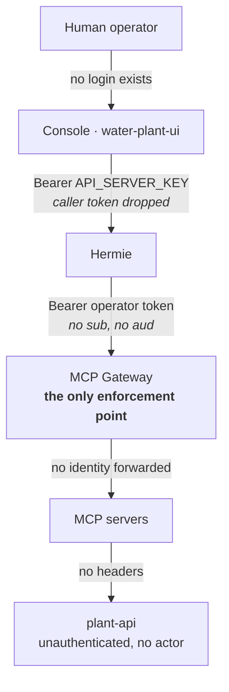
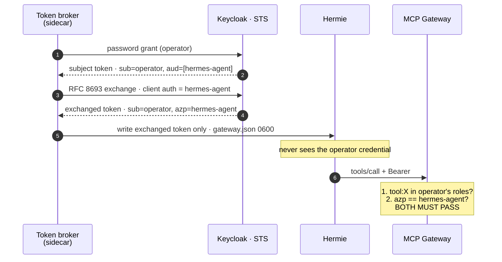
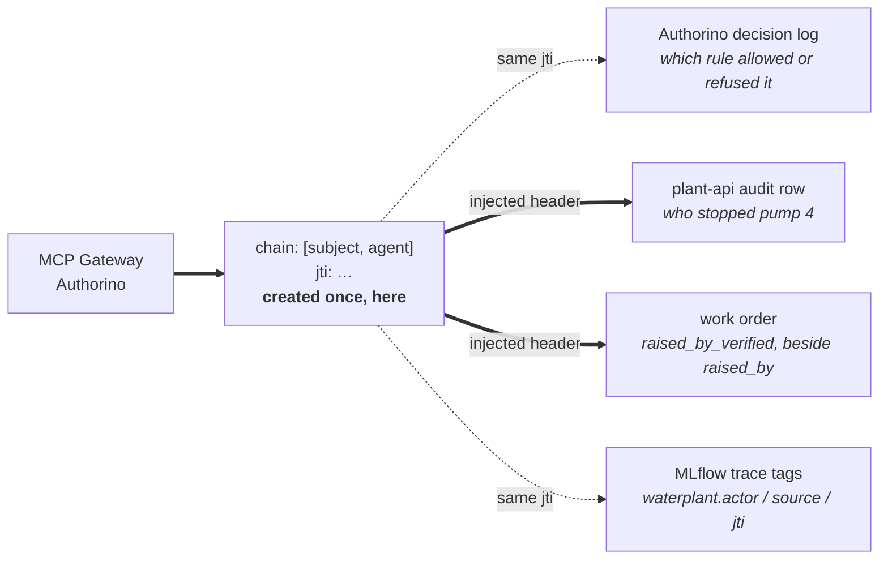
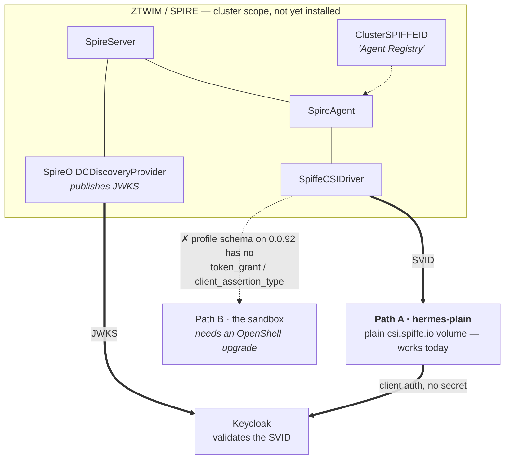

# Who Is Hermie Acting For?

> **Design note.** A condensed, narrative version of the documents in this folder.
> Published as a page at <https://claude.ai/artifact/XS69pJVcoRHeVupzp4L82T> — same content,
> diagrams rendered. Start with [README.md](README.md) for the index, or
> [00-verification-findings.md](00-verification-findings.md) for the evidence.

Hermie is the waterplant assistant participants operate in the AgentOps lab. It can read telemetry,
stop pumps, write reports and shut down the plant. Today the platform cannot say who asked it to.

**Status: design only.** Nothing implemented. No chart, no image, no lab content changed. Every
claim below was verified read-only against a live three-tenant cluster on 2026-11-19.

## The token Hermie presents on every tool call

Decoded live from `/app/.hermes/mcp-tokens/gateway.json`:

```jsonc
{
  "azp":             "mcp-gateway",        // ← the shared public client
  "iss":             "…/realms/waterplant-user-9c5ls",
  "jti":             "…",
  "scope":           "roles groups",
  "resource_access": { /* 3 clients, 18 tool roles */ },

  "sub":                 ABSENT,
  "aud":                 ABSENT,
  "preferred_username":  ABSENT
}
```

Eighteen permissions. No principal. The agent does not *borrow* the operator's identity — there is
no identity in the token at all.

## Two failures, and this lab has both

[Uber's agent identity post](https://www.uber.com/us/en/blog/solving-the-agent-identity-crisis/)
names an **identity model gap** and **lost provenance**. Here they take a sharper form than Uber
describes.

The token refresher runs an OAuth2 password grant as realm user `operator` through the shared
public client, and writes the bearer to a file Hermie reads. So the MCP Gateway can only ever ask
*"does the operator hold `tool:X`?"* — never *"is this agent allowed to act for this human?"*
There is no agent to ask about.

And nothing downstream recovers what was never there. MLflow traces are written under one
ServiceAccount per tenant. Attack probes are byte-identical to human turns. The only "who" anywhere
in the system is `raised_by` on a work order — a free-text field the *model* fills in, defaulting to
`"unknown"`, in the same column as seeded human handles like `a.okafor`.

The repo already asks for the fix, in `attack-eval-runner/plant_state.py:14-20`:

> "Recommend a distinct `attack-runner` user rather than reusing `operator`: reusing it would make
> attack traffic indistinguishable from the participant's own in every trace they inspect, which is
> precisely what modules 4 and 5 are teaching them to tell apart."

## Figure 1 — One credential, six hops, no principal

Identity is not lost somewhere in the chain. It is never created — there is no login anywhere in
the lab — and two synthetic credentials stand in for it.



**Principal carried at any hop: none.** The browser sends only `content-type`; the console
substitutes a static service key and drops the caller's header on purpose
(`ui/src/waterplant_ui/harness.py:255-270`); the one real credential names a client, not a person.
Below the gateway nothing reads identity at all.

## Figure 2 — What the token says, in three stages

| | Today | + subject & audience mappers | + RFC 8693 exchange |
|---|---|---|---|
| `azp` | `mcp-gateway` | `mcp-gateway` | **`hermes-agent`** |
| `sub` | — | **`operator`** | `operator` |
| `aud` | — | **`hermes-agent`** | **gateway resource** |
| `resource_access` | 18 roles | 18 roles | 18 roles |
| | *18 permissions, no principal* | *a human is named; the exchange becomes possible* | *who, and which software, in one signed token* |

Stage two is a **hard prerequisite**, not a refinement: Keycloak's standard token exchange requires
the requesting client to be the subject token's `azp` or to appear in its `aud`. Today it is
neither, so the exchange would fail with `400 "Client is not within the token audience"`.

## Figure 3 — A broker holds the credential, not the agent

The structural move is that the component holding the operator's credential is not the agent. That
split already exists physically — `MCP_USERNAME` and `MCP_PASSWORD` live on the
`mcp-token-refresh` sidecar, and the `hermes` container only ever reads the token file. This design
gives it a purpose.



The agent cannot mint its own authority — it reads a file. It cannot obtain a token for a subject
nobody authenticated, and it cannot widen its own scope.

> ### Why both facts must live in one token
>
> The tempting alternative is to validate two credentials at the gateway and require both.
> **Authorino cannot express that.** Its `authentication` rules are **OR**, not AND — multiple JWT
> rules mean "any one of these succeeds". Binding both facts into a single verified identity is what
> the token exchange buys, and it is the load-bearing reason for this design rather than a stylistic
> preference.

## Figure 4 — Intersection, not substitution

One CEL predicate added to the rule that already exists. Predicates within a `patternMatching`
block are AND-ed, so it composes with what is there:

```cel
has(auth.identity.azp) && auth.identity.azp == 'hermes-agent'
```

| | operator token | exchanged token |
|---|---|---|
| **holds `tool:X`** | **403** — no agent identity | **allow** — both conditions met |
| **lacks `tool:X`** | **403** — both checks fail | **403** — *agent alone is not enough* |

The bottom-right cell is the point: an agent identity grants nothing on its own, it only qualifies
*how* the operator's permissions may be used. That is Uber's "evaluate both the personnel identity
and the agent identity simultaneously", expressed in the one place this lab already enforces policy.

Top-left matters operationally — a raw operator token stops working once the rule is enforced, which
is why enforcement sits behind a per-tenant flag until the broker is proven.

## Figure 5 — One `jti` turns four logs into an audit trail

Identity at the gateway solves authorization. It does not solve attribution — and attribution is
what this lab runs on. Every module from 1 to 6 asks participants to prove something from a trace, a
tool result, or plant state, and none of those records a principal.



`jti` — already present in today's token — is the join key. It also replaces the current correlation
method, which compares a casefolded 120-character prefix of `request_preview`: clever, but a
heuristic standing in for an identifier.

> ### Keep `raised_by`. Add `raised_by_verified` beside it.
>
> Today the *model* decides who raised a work order — an ordinary tool argument defaulting to
> `"unknown"`, in the same column as seeded handles like `a.okafor`. The instinct is to make the
> field server-derived. **Don't:** the *pair* is the teaching artifact. An agent asserting a
> plausible human name next to a verified actor saying otherwise is the entire lesson about
> self-asserted identity, visible in two columns of one record. Overwriting it erases the comparison.

## Figure 6 — Where the agent's credential comes from

The client secret is an interim measure. The target is a credential the agent cannot copy or leak,
because it is issued to the workload on the basis of attestation — and Red Hat ships the product for
it. **Zero Trust Workload Identity Manager v1.1.3** is in this cluster's catalogue and not installed.



Prove the SVID on `hermes-plain` first — that isolates the Keycloak question from the OpenShell
question entirely, and the console already targets `hermes-plain` at baseline. With attestation
there is also no secret to keep out of git, which closes the objection that removed the original
agent client.

## What maps cleanly, and what does not

| Uber primitive | Here | Fidelity |
|---|---|---|
| Workload SVID from SPIRE | X509 / JWT-SVID from ZTWIM | **faithful** — same project, Red Hat supported |
| Agent Registry | `ClusterSPIFFEID` + the `hermes-agent` client | **good** — two objects, same property |
| STS token exchange | Keycloak standard token exchange V2 | **faithful** — verified advertised on the realm |
| Per-hop audience-scoped token | Fixed audience mapper, 300 s refresh | **partial** — only one downstream hop exists to scope |
| `act_chain` — nested lineage | The `sub` + `azp` pair | **substitute** — two flat claims, two hops |
| Policy on personnel *and* agent identity | Authorino intersection rule | **faithful** — the cleanest match in the mapping |
| MCP Gateway as policy enforcement point | MCP Gateway with Kuadrant AuthPolicies | **already identical** |
| Standardized agent-to-agent client | Nothing | **out of scope** — no A2A path in this lab |

**The one place this stack is ahead.** Module 2 already teaches credential mediation. Participants
create a sandbox with `--provider maas`, and OpenShell puts an opaque placeholder in the environment
while swapping the real model key in at the egress proxy — the agent authenticates to the model
perfectly well and never holds the credential. That is the same principle as Uber's STS, already
working, already in the lab guide. Identity would be the *second* instance of a pattern participants
have already met.

## The actor chain is a substitute, and will stay one for now

**`sub`** is who the token is *about*; **`azp`** is which OAuth client it was *issued to*. Together
they say "the operator is the principal, `hermes-agent` is the software acting for them". That is
two hops, which is all this lab has.

But RFC 8693's `act` is a purpose-built *nested* structure — an ordered lineage, each entry with its
own `sub` and `iat`, recursable to any depth, under a standard name other verifiers already
understand. Two flat claims are a local convention, not an interoperable one, and a second agent in
the path would have nowhere to be recorded.

**Delegation needs Keycloak 26.8+**, a preview feature, and FGAP V2. We run RHBK 26.4.18. RHBK maps
1:1 to upstream and tracks only even-numbered minors, with the default already moved to the 26.6
stream — so an RHBK 26.8 is plausible but does not exist. And decisively, **we do not own that
Keycloak**: it is RHDP-provisioned and serves every realm on the cluster.

**FGAP**, for the record, is **Fine-Grained Admin Permissions** — Keycloak's model for scoped admin
rights instead of all-or-nothing `realm-admin`. Delegation is gated through its V2 `delegate` scope,
so "may this agent act for this user?" is itself an FGAP decision. It has been GA since 26.2 and is
available on our realm today, currently off. **FGAP is not the blocker.**

> ### The one decision that keeps the upgrade cheap
>
> **Model the actor as an ordered list from day one**, even while it only ever holds two entries.
> The injected header, `raised_by_verified`, and the trace tag should all be chain-shaped from the
> start. Then moving to a real `act` claim changes only *where the list is populated from* — one
> predicate, one CEL expression, about fifteen lines in the broker.
>
> Model it as two scalar fields instead and the same move means changing the plant-api schema, the
> tag format, the header parser, and every QA assertion that reads them. Same destination, an order
> of magnitude more work. Choosing the list costs nothing today.

## Phases 1–4 need no image rebuild

A consequence of the console targeting `hermes-plain` at baseline: the whole authorization half can
be built in charts and one Python script.

| # | Phase | Notes |
|---|---|---|
| 0 | **Verification** ✅ done | Changed two things in the design: OpenShell cannot do SPIFFE-backed token grants on this build, and the MCP servers have a native identity surface |
| 1 | Prove the exchange works at all | Audience mapper, subject mapper, the `hermes-agent` client. Applied by hand via the admin REST API — because of the `--override=false` import Job, a chart change would not reach a live tenant anyway |
| 2 | Enforce the intersection, in shadow mode | Guard the rule on a header no real traffic sends, so it applies to a probe and skips for Hermie. Probe with `get_pump_status` only — never `stop_pump`, which would actually stop the pump |
| 3 | Switch the real agent over, and put it in git | The broker gains the exchange step, env-gated so it is a no-op without configuration, and **fails closed** |
| 4 | The sandbox, without rebuilding the image | `start-hermes` sets `SHARE` before sourcing the bridge-rendered env file, so that file can redirect it and keep the image pinned |
| 5 | Provenance into the MCP servers and plant-api | **image build** — gated on whether the gateway propagates Authorino's success headers |
| 6 | Console: automatic operator identity and trace tags | **image build** — a background task mirroring the broker. No login, ever |
| 7 | SPIFFE, behind a spike | Prove the SVID on `hermes-plain` first. Test mTLS client auth with an X509-SVID before the JWT-SVID assertion route |

> ### The highest risk is not cryptographic
>
> Enforcing the agent identity turns any broker or Keycloak hiccup into "the agent has no tools" —
> and the repo already documents that Hermes misreports a 403 as "a network issue or service
> outage". With 30 tenants against a MaaS endpoint that returned 52 HTTP 429s across 15 runs of a
> single sequential client, a transient failure mid-exercise is plausible. Keep enforcement behind a
> per-tenant flag, and accept that failing closed is still correct.

## Four questions that need a person, not a command

1. **Does this become a workshop module, or stay platform work?** It changes what gets built. A
   module needs a participant-visible before/after and 15–20 minutes carved out of a full 120.
2. **Is a two-hop `sub`+`azp` chain good enough to teach?** It is honest and demonstrates the
   principle. But a lab about agent identity that cannot show a real `act` claim may want to say so
   explicitly rather than leave a reader to notice.
3. **Should `attack-runner` get its own agent instance?** The cheap version fixes trace attribution.
   Only a second Hermes makes probe *tool calls* distinguishable at the gateway, and that costs a pod
   and a second stream of model calls per tenant.
4. **How much of the deliberate insecurity should identity close?** `plant-api` having no auth is a
   documented lab starting condition, not an oversight. Adding an audit trail records actors without
   adding enforcement — but confirm that is the intent before building it.

---

Verified read-only against a live three-tenant build, 2026-11-19. No chart, image, or lab content
changed. Northgate Water Treatment Works is fictional; every pump, record and credential in the lab
is invented.
